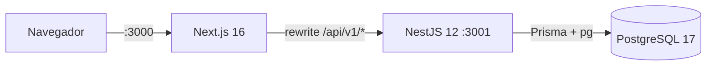

# POS — Sistema de punto de venta

Monorepo del sistema POS. **Estado actual: Fase 0 (bootstrap)**. En esta fase solo
existe la infraestructura: contenedores de web, API y base de datos conectados
entre sí, endpoint de salud que consulta PostgreSQL y documentación Swagger. No
hay autenticación, productos, inventario, ventas ni KPIs todavía.

## Stack

| Componente   | Versión                                                   |
| ------------ | --------------------------------------------------------- |
| Node.js      | 26 (`node:26-bookworm-slim`)                              |
| pnpm         | 12.16.1                                                   |
| NestJS       | 12.4.0 (ESM)                                              |
| Next.js      | 16.4.5 + React 19.3.1                                     |
| Prisma       | 7.10.1 + `@prisma/adapter-pg`                             |
| PostgreSQL   | 17 (alpine)                                               |
| TypeScript   | 5.9.3                                                     |
| Tailwind CSS | 4.3.5                                                     |
| Tests        | Jest 30 + ts-jest (API), Vitest 5 + Testing Library (web) |

## Requisitos

- Docker Engine 29+ con Docker Compose v2/v5.
- `make` (opcional, pero recomendado: encapsula todos los comandos).

No se necesita Node.js ni pnpm en el host: todo se ejecuta dentro de contenedores.

## Estructura

```
.
├── apps/
│   ├── api/            # NestJS 12 (ESM) + Prisma 7 + Swagger
│   │   ├── prisma/     # schema.prisma, seed y (Fase 1) migraciones
│   │   ├── src/
│   │   │   ├── config/ # validación de variables de entorno
│   │   │   ├── health/ # GET /api/v1/health
│   │   │   └── prisma/ # PrismaService con adaptador pg
│   │   └── test/       # e2e con Supertest
│   └── web/            # Next.js 16 (App Router) + Tailwind 4
│       └── src/
│           ├── app/        # layout, page y tokens M3 (globals.css)
│           ├── components/ # AppShell (top app bar + navegación)
│           └── lib/        # apiFetch
├── infra/postgres/     # init.sql (crea pos_test)
├── docker-compose.yml  # db + api + web en la red pos-net
└── Makefile
```

## Puesta en marcha

```bash
cp .env.example .env      # opcional: docker-compose tiene valores por defecto
make up                   # docker compose up -d --build
make ps                   # estado de los servicios
make logs                 # logs en vivo
```

Servicios resultantes:

| Servicio   | URL                                                     |
| ---------- | ------------------------------------------------------- |
| Web        | http://localhost:3000                                   |
| API        | http://localhost:3001/api/v1                            |
| Swagger    | http://localhost:3001/api/docs                          |
| PostgreSQL | `localhost:5432` (base `pos`, base de tests `pos_test`) |

No se usan bind mounts: el código vive dentro de las imágenes. Después de cambiar
código hay que reconstruir (`make build` o `docker compose up -d --build`).

## Arquitectura de la fase 0



- **web**: shell mínimo Material You (top app bar, navegación lateral, superficies
  tonales). El rewrite de `next.config.ts` envía `/api/v1/:path*` a
  `API_INTERNAL_URL` (por defecto `http://api:3001`), por lo que el navegador
  siempre habla con un único origen.
- **api**: prefijo global `/api/v1`, `ValidationPipe` global, `helmet`,
  `cookie-parser`, Swagger en `/api/docs`.
- **db**: volumen `pgdata`; `infra/postgres/init.sql` crea la base `pos_test` que
  consumen las pruebas e2e.

## Endpoint de salud

`GET /api/v1/health` no requiere autenticación. Responde **200** cuando la base de
datos responde y **503** cuando no.

```json
{
  "status": "ok",
  "database": "up",
  "timestamp": "2026-01-15T12:34:56.789Z"
}
```

Cuando PostgreSQL no responde:

```json
{
  "status": "error",
  "database": "down",
  "timestamp": "2026-01-15T12:34:56.789Z"
}
```

El contenedor `api` usa este endpoint como healthcheck; `web` arranca solo cuando
la API está saludable.

## Comandos

| Comando                                     | Descripción                                    |
| ------------------------------------------- | ---------------------------------------------- |
| `make up`                                   | Construye y levanta `db`, `api` y `web`        |
| `make down`                                 | Detiene los contenedores (conserva el volumen) |
| `make build`                                | Reconstruye las imágenes                       |
| `make logs` / `make ps`                     | Logs en vivo / estado                          |
| `make migrate`                              | `prisma migrate dev` sobre la base `pos`       |
| `make seed`                                 | Ejecuta `prisma/seed.mjs`                      |
| `make api-test`                             | Jest unitario de la API                        |
| `make api-e2e`                              | Jest e2e contra `pos_test`                     |
| `make web-test`                             | Vitest de la web                               |
| `make lint-api` / `make lint-web`           | ESLint                                         |
| `make typecheck-api` / `make typecheck-web` | `tsc --noEmit`                                 |

Los targets de test aceptan `FILE=` para acotar el archivo:

```bash
make api-e2e FILE=health.e2e-spec.ts
make web-test FILE=src/components/app-shell.test.tsx
```

Sin `FILE`, corren todos los archivos del proyecto.

## Pruebas de la fase 0

```bash
# 1. Imagen de la API
docker compose build api

# 2. Base de datos saludable
docker compose up -d db

# 3. e2e contra la base de tests
docker compose run --rm \
  -e DATABASE_URL=postgresql://pos:pos@db:5432/pos_test \
  api pnpm test:e2e -- health.e2e-spec.ts

# 4. Imagen de la web
docker compose build web

# 5. Test del shell de la aplicación
docker compose run --rm web pnpm test -- src/components/app-shell.test.tsx

# 6. Humo end-to-end
docker compose up -d api web
curl -f http://localhost:3001/api/v1/health
curl -f http://localhost:3000
```

## Credenciales

Todavía no aplican: la Fase 0 no tiene autenticación. `JWT_ACCESS_SECRET` y
`JWT_REFRESH_SECRET` se validan como opcionales en `src/config/env.validation.ts`
y se usarán en la fase de autenticación.

## Notas técnicas

- **NestJS 12 es ESM**: el paquete declara `"type": "module"`, los imports
  relativos llevan extensión `.js` y el proyecto compila con `module: nodenext`.
- **Prisma 7** genera el cliente con el generator `prisma-client` en
  `apps/api/src/generated/prisma` (ignorado por git) y requiere un _driver
  adapter_; `PrismaService` usa `PrismaPg`. La URL de la base se lee de
  `prisma.config.ts`, no del `schema.prisma`.
- **Jest en ESM** requiere `NODE_OPTIONS=--experimental-vm-modules`; los scripts
  `test` y `test:e2e` ya lo incluyen.
- **Tailwind 4** define los tokens Material You con `@theme inline` sobre
  variables CSS, por lo que el modo oscuro funciona con `prefers-color-scheme`
  sin prefijos `dark:`.
