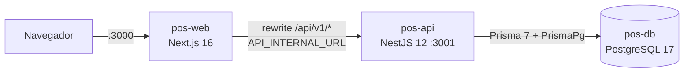
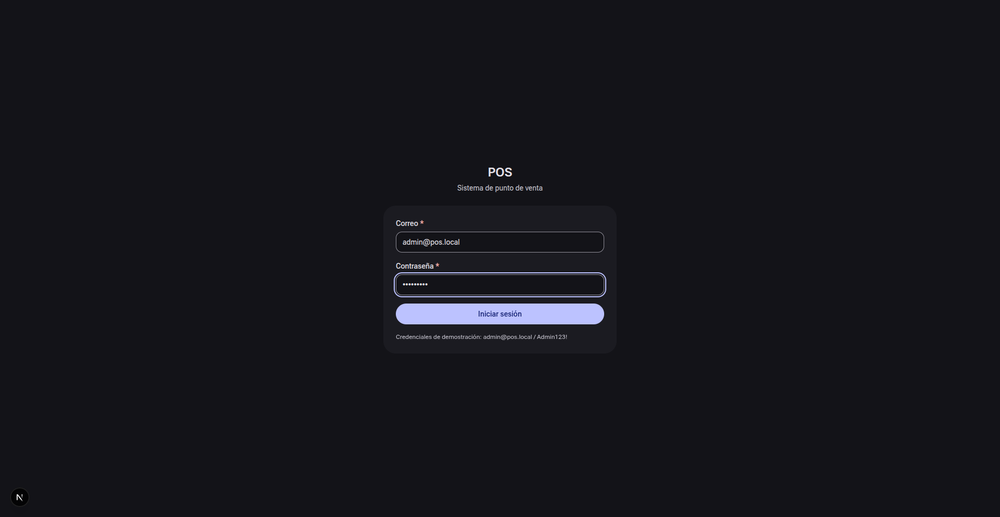
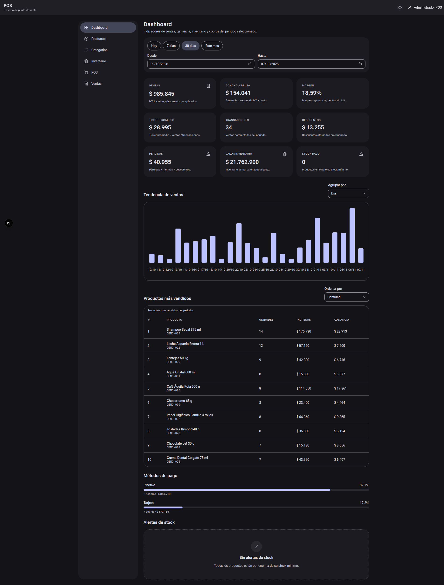
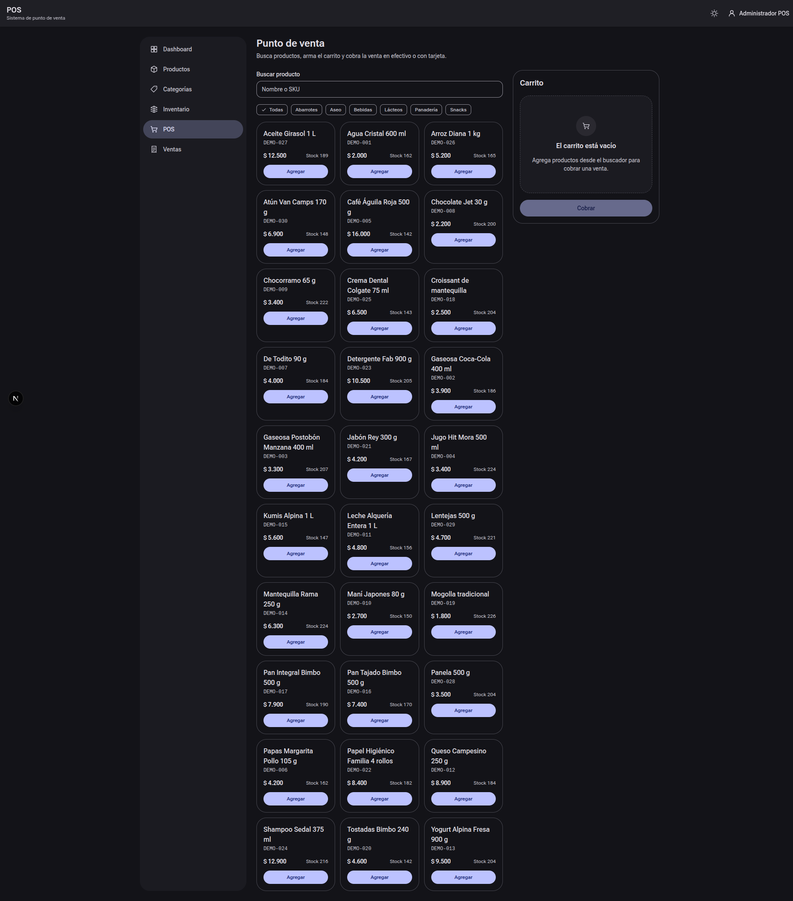
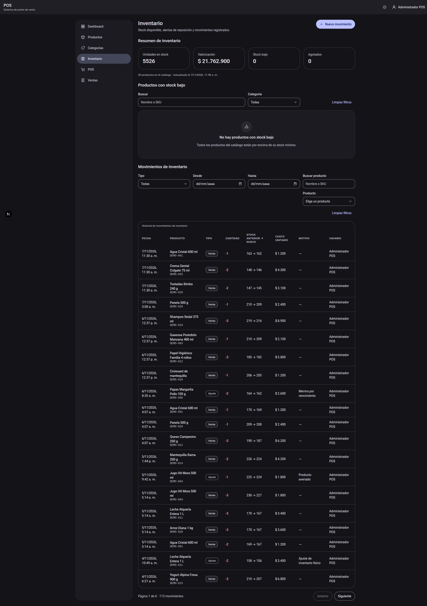
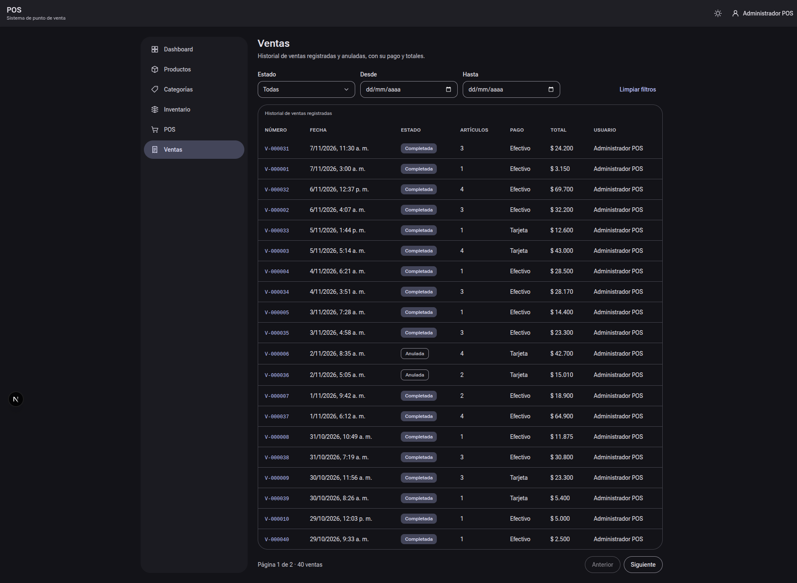
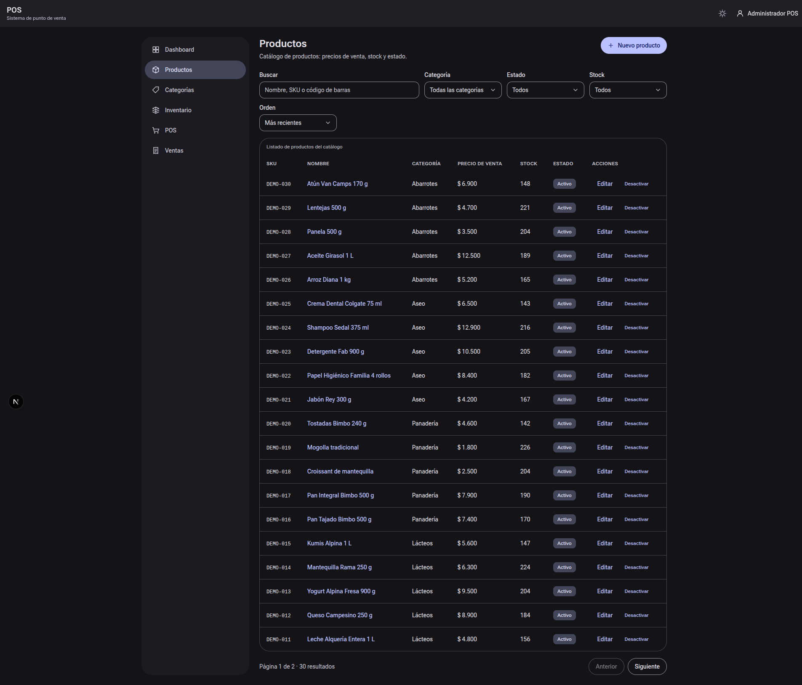
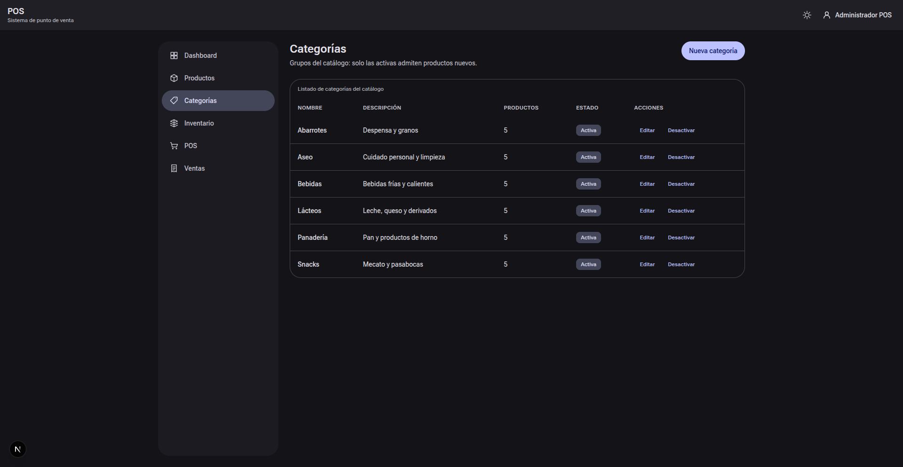

# POS — Sistema de punto de venta

Monorepo de un **punto de venta (POS)** para comercio de barrio: catálogo de productos y categorías, inventario con movimientos, ventas transaccionales, anulación con devolución de stock y tablero de KPIs. Todos los importes están en **pesos colombianos (COP)** con el **IVA del 19 % incluido en el precio de venta** y la operación diaria se lee en la zona **`America/Bogota`**.

El proyecto corresponde al **cierre técnico** del producto: calidad medida, cobertura con umbrales, filtro global de errores e índices de rendimiento, sobre la versión **v1.0.0** documentada en Swagger.

> **Estado:** v1.0.0 — cierre técnico. Suite completa en verde: **488/488** pruebas (220 unitarias de API, 95 e2e de API y 173 de la web).

> **Acceso de demostración:** usuario `admin@pos.local` · contraseña `Admin123!` · rol `ADMIN`.

> **Note:** la versión v1.0.0 es la del producto y de la API (Swagger); los `package.json` del monorepo siguen en `0.1.0`.

## Estado del proyecto

Versión **v1.0.0** cerrada en `main` y lista para entrega. Alcance cubierto:

- Monorepo pnpm (`apps/api` + `apps/web`) con Docker Compose y `make` como interfaz de operación.
- API NestJS con autenticación por cookies, catálogo, inventario, ventas y KPIs, documentada en Swagger.
- Web Next.js con las pantallas de login, dashboard, productos, categorías, inventario, POS y ventas.
- 488 pruebas en verde (220 unitarias de API, 95 e2e de API y 173 de la web) con umbrales de cobertura activos.
- CI en GitHub Actions: lint, typecheck, unitarios, e2e y build.
- Semilla base y semilla de demostración reproducibles (`faker.seed(2026)`).

## Índice

- [Estado del proyecto](#estado-del-proyecto)
- [Stack](#stack)
- [Requisitos](#requisitos)
- [Puesta en marcha](#puesta-en-marcha)
- [Estructura](#estructura)
- [Arquitectura](#arquitectura)
- [Módulos y endpoints](#módulos-y-endpoints)
- [Rutas del frontend](#rutas-del-frontend)
- [Capturas](#capturas)
- [Comandos del Makefile](#comandos-del-makefile)
- [Seeds y datos de demostración](#seeds-y-datos-de-demostración)
- [Testing y cobertura](#testing-y-cobertura)
- [Seguridad](#seguridad)
- [Reglas de negocio](#reglas-de-negocio)
- [Documentación](#documentación)
- [Solución de problemas](#solución-de-problemas)

## Stack

| Componente     | Versión                                | Notas                                                        |
| :------------- | :------------------------------------- | :----------------------------------------------------------- |
| Node.js        | 26 (`.nvmrc`, imagen `node:26-bookworm-slim`) | Solo dentro de los contenedores                        |
| pnpm           | 12.16.1                                | Workspace con `nodeLinker: hoisted`                           |
| NestJS         | 12.4.0 (`@nestjs/common`, `core`, `platform-express`) | API en ESM                                    |
| `@nestjs/config` / `@nestjs/swagger` | 12.1.1 / 12.1.1        | Validación de entorno y documentación viva                    |
| Prisma         | 7.10.1 + `@prisma/adapter-pg` 7.10.1 + `pg` 8.23.1 | Driver adapter `PrismaPg`                       |
| Next.js        | 16.4.5 (App Router) + React 19.3.1     | Salida `standalone` y rewrite same-origin                     |
| Tailwind CSS   | 4.3.5 (`@tailwindcss/postcss` 4.3.5)   | Tokens Material You con `@theme inline`                       |
| TanStack Query | 5.107.1                                | Estado remoto bajo demanda                                    |
| Zustand        | 5.1.0                                  | Carrito del POS con `persist`                                 |
| react-hook-form + zod | 7.91.0 + 4.6.7                  | Formularios y validación del cliente                          |
| Radix UI       | `dialog` 1.3.1, `dropdown-menu` 2.2.1, `select` 2.4.1, `toast` 1.3.1 | Primitivas accesibles de la UI     |
| bcryptjs       | 3.0.3                                  | Hash de contraseñas (coste 12)                                |
| helmet         | 8.3.0                                  | Cabeceras de seguridad                                        |
| class-validator / class-transformer | 0.14.2 / 0.5.1    | Validación de payloads                                        |
| PostgreSQL     | 17 (alpine)                            | Bases `pos` y `pos_test`                                      |
| TypeScript     | 5.9.3 (fijado en `pnpm-workspace.yaml`) | `module: nodenext` en la API                                 |
| Faker / tsx    | 10.6.0 / 4.23.15                       | Factories, seeds y e2e                                        |
| Tests          | Jest 30.5.2 + ts-jest 29.4.15 (API), Vitest 5.1.0 + Testing Library (web) | Unitarios, e2e y web |
| Docker         | Engine 29+ con Compose v5              | Verificado en Engine 29.9.3 / Compose v5.7.0                  |

## Requisitos

| Requisito            | Detalle                                                                 |
| :------------------- | :---------------------------------------------------------------------- |
| Docker Engine 29+    | Con Docker Compose v5 (plugin `docker compose`)                          |
| `make`               | Interfaz única de operación (opcional, pero recomendada)                 |
| curl                 | Solo para el smoke test (`make smoke`)                                   |

**No se necesita Node.js ni pnpm en el host**: el código, las dependencias y las herramientas viven dentro de las imágenes y no hay `node_modules` local.

## Puesta en marcha

```bash
cp .env.example .env      # opcional: docker-compose trae valores por defecto
make up                   # docker compose up -d --build -> db, api y web
make migrate              # aplica las migraciones de Prisma sobre la base `pos`
make seed                 # datos base (o `make seed-demo` para la demo completa)
make ps                   # estado de los servicios
make logs                 # logs en vivo
```

Servicios resultantes:

| Servicio   | URL                                                   |
| :--------- | :---------------------------------------------------- |
| Web        | http://localhost:3000                                  |
| API        | http://localhost:3001/api/v1                            |
| Swagger    | http://localhost:3001/api/docs (JSON en `/api/docs/json`) |
| PostgreSQL | `localhost:5432` (bases `pos` y `pos_test`)             |

Credenciales creadas por los seeds:

| Usuario           | Contraseña  | Rol     |
| :---------------- | :---------- | :------ |
| `admin@pos.local` | `Admin123!` | `ADMIN` |

Comprobación rápida de que todo responde:

```bash
make smoke
# health de la API -> login real con cookies -> lecturas de productos,
# inventario, ventas y dashboard -> /login de la web
```

> **Warning:** no se usan bind mounts: el código vive dentro de las imágenes. Tras cambiar cualquier archivo hay que reconstruir (`make build` o `make up`); el `--watch` de Nest no ve el host.

## Estructura

```text
.
├── apps/
│   ├── api/            # NestJS 12 (ESM) + Prisma 7 + Swagger
│   │   ├── prisma/     # schema, migraciones, factories, seeds y truncate
│   │   ├── src/        # common, config, health, modules, prisma
│   │   └── test/       # e2e con Supertest + helpers (auth, db)
│   └── web/            # Next.js 16 (App Router) + Tailwind 4 + Material You
│       └── src/        # app, components, lib, stores, middleware.ts
├── docs/               # documentación técnica (ver §Documentación)
├── infra/postgres/     # init.sql (crea la base pos_test)
├── scripts/smoke.sh    # humo end-to-end
├── .github/workflows/  # CI: lint, typecheck, unit, e2e y build
├── docker-compose.yml  # db + api + web en la red pos-net
├── pnpm-workspace.yaml # hoisted, allowBuilds, overrides
└── Makefile            # interfaz única de operación
```

## Arquitectura



- **web**: App Router con tokens Material You; `next.config.ts` reescribe `/api/v1/:path*` hacia `API_INTERNAL_URL` (por defecto `http://api:3001`), así el navegador habla con **un único origen** y las cookies viajan siempre al mismo dominio.
- **api**: prefijo global `/api/v1`, `ValidationPipe` global, `helmet`, `cookie-parser`, CORS con credenciales, guards globales en orden (rate limit → `Origin` → auth → roles), filtro global de errores y Swagger en `/api/docs`.
- **db**: volumen `pos-pgdata`; `infra/postgres/init.sql` crea la base `pos_test` que consumen los e2e. La base `pos` la crea `POSTGRES_DB`.
- **Red y salud**: los tres servicios viven en la red `pos-net`; `db` publica `pg_isready`, `api` publica `/api/v1/health` y `web` publica su raíz, con `depends_on: service_healthy` encadenando el arranque.

El detalle completo (capas, orden de guards, flujo de una venta) está en [docs/ARQUITECTURA.md](docs/ARQUITECTURA.md).

## Módulos y endpoints

| Módulo     | Rutas principales                                                                 | Acceso  |
| :--------- | :-------------------------------------------------------------------------------- | :------ |
| Health     | `GET /health`                                                                     | Público |
| Auth       | `POST /auth/login`, `POST /auth/refresh`, `POST /auth/logout`, `GET /auth/me`      | Público / sesión |
| Users      | `GET /users`, `POST /users`, `PATCH /users/:id`, `PATCH /users/:id/password`, `PATCH /users/:id/deactivate` | `ADMIN` |
| Categories | `GET /categories`, `POST /categories`, `PATCH /categories/:id`, `DELETE /categories/:id` | `ADMIN` |
| Products   | `GET /products`, `POST /products`, `GET /products/:id`, `PATCH /products/:id`, `DELETE /products/:id`, `GET /products/:id/price-history` | `ADMIN` |
| Inventory  | `POST /inventory/movements`, `GET /inventory/movements`, `GET /inventory/low-stock`, `GET /inventory/summary`, `GET /products/:id/stock-movements` | `ADMIN` |
| Sales      | `POST /sales`, `GET /sales`, `GET /sales/:id`, `GET /sales/:id/receipt`, `POST /sales/:id/void` | `ADMIN` |
| Dashboard  | `GET /dashboard/summary`, `GET /dashboard/sales-trend`, `GET /dashboard/top-products`, `GET /dashboard/payment-methods`, `GET /dashboard/low-stock` | `ADMIN` |

Todas las rutas cuelgan del prefijo `/api/v1` (por ejemplo `http://localhost:3001/api/v1/sales`).

> **Note:** **Swagger es la fuente viva del contrato** (`http://localhost:3001/api/docs`). Ahí están los parámetros, los ejemplos reales y todas las respuestas de error; este README solo resume. El contrato en prosa, con ejemplos `curl`, está en [docs/API.md](docs/API.md).

## Rutas del frontend

| Ruta                | Grupo   | Contenido                                                              |
| :------------------ | :------ | :--------------------------------------------------------------------- |
| `/`                 | —       | Redirige a `/dashboard`                                                |
| `/login`            | `(auth)` | Formulario de acceso (única ruta pública)                              |
| `/dashboard`        | `(app)` | KPIs, tendencia de ventas, top de productos, métodos de pago y alertas  |
| `/productos`        | `(app)` | Catálogo con filtros, orden y búsqueda                                 |
| `/productos/nuevo`  | `(app)` | Alta de producto (stock inicial `0`)                                   |
| `/productos/[id]`   | `(app)` | Detalle, edición e historial de precios                                |
| `/categorias`       | `(app)` | Listado, alta, edición y desactivación de categorías                    |
| `/inventario`       | `(app)` | Valorización, stock bajo y movimientos (entradas y ajustes)             |
| `/pos`              | `(app)` | Buscador, carrito, descuento, totales y cobro                          |
| `/ventas`           | `(app)` | Historial de ventas con filtro por estado                              |
| `/ventas/[id]`      | `(app)` | Detalle de venta, comprobante y anulación                              |

`apps/web/src/middleware.ts` decide el acceso por **presencia de cookie** (`access_token` o `refresh_token`): sin sesión redirige a `/login` y, con sesión, `/login` y `/` van a `/dashboard`. La autoridad real sigue siendo el guard de la API.

## Capturas

Las imágenes vivas del sistema con el seed de demostración están en [`docs/CAPTURAS/`](docs/CAPTURAS/) y su descripción en [docs/CAPTURAS/README.md](docs/CAPTURAS/README.md).

| Acceso | Indicadores | Venta |
| :----- | :---------- | :---- |
|  |  |  |

| Inventario | Historial de ventas | Productos | Categorías |
| :--------- | :------------------ | :-------- | :--------- |
|  |  |  |  |

## Comandos del Makefile

`make` o `make help` listan todos los targets.

| Comando                        | Descripción                                                                  |
| :----------------------------- | :--------------------------------------------------------------------------- |
| `make up`                      | Construye y levanta `db`, `api` y `web`                                       |
| `make down`                    | Detiene los contenedores (conserva el volumen)                                |
| `make logs`                    | Sigue los logs de todos los servicios                                         |
| `make ps`                      | Estado de los servicios                                                       |
| `make build`                   | Reconstruye las imágenes de `api` y `web`                                     |
| `make migrate`                 | `prisma migrate dev` sobre la base `pos`                                      |
| `make migrate-deploy`          | `prisma migrate deploy` sin prompts (CI/producción)                           |
| `make migrate-test`            | `prisma migrate deploy` sobre `pos_test`                                      |
| `make seed`                    | Seed base idempotente (admin, 6 categorías y 12 productos)                    |
| `make seed-demo`               | Datos de demostración (vacía el negocio antes)                                |
| `make api-test`                | Pruebas unitarias de la API (Jest)                                            |
| `make api-e2e`                 | Migra `pos_test` y corre las pruebas e2e (Supertest)                          |
| `make web-test`                | Pruebas de la web (Vitest)                                                    |
| `make api-test-cov`            | Cobertura de los unitarios de la API (umbral 70/70/60)                        |
| `make api-e2e-cov`             | Cobertura e2e de la API contra `pos_test` (migra antes)                       |
| `make web-test-cov`            | Cobertura de la web (umbral 60/60/50)                                         |
| `make test-all`                | Cobertura completa: API (unit + e2e) y web                                    |
| `make lint` / `make lint-api` / `make lint-web` | ESLint del workspace, de la API o de la web            |
| `make typecheck` / `make typecheck-api` / `make typecheck-web` | `tsc --noEmit` del workspace, de la API o de la web |
| `make db-shell` / `make psql`  | Shell dentro de `db` / cliente `psql` sobre `pos`                             |
| `make reset`                   | Reinicia la base `pos`: `prisma migrate reset --force` + seed base             |
| `make test-reset`              | **Destruye el volumen** (`down -v`), reconstruye y levanta de cero             |
| `make smoke`                   | Humo end-to-end con `scripts/smoke.sh`                                        |

Los targets de test aceptan `FILE=` para acotar la corrida, con varios patrones separados por espacio:

```bash
make api-test FILE=src/modules/sales/sales.service.spec.ts
make api-e2e FILE="test/sales.e2e-spec.ts test/sales-void.e2e-spec.ts"
make web-test FILE=src/components/layout/app-shell.test.tsx
```

Sin `FILE`, cada target ejecuta **toda** la suite de su proyecto. `make api-e2e` y `make api-e2e-cov` aplican antes `prisma migrate deploy` sobre `pos_test` (`make migrate-test`).

## Seeds y datos de demostración

| Seed | Comando          | Contenido                                                                                                        |
| :--- | :--------------- | :--------------------------------------------------------------------------------------------------------------- |
| Base | `make seed`      | Upsert del administrador, 6 categorías y 12 productos (sin ventas). Idempotente; restablece la contraseña.        |
| Demo | `make seed-demo` | Vacía el negocio y genera 30 productos, 40 ventas de los últimos 30 días (6 anuladas), 5 mermas y 5 cambios de precio. |

Ambos usan `faker.seed(2026)`, así que los datos son reproducibles, y comparten el `truncate` que reinicia la secuencia `sale_number_seq`.

Para volver a un estado limpio:

```bash
make reset          # migrate reset --force + seed base (conserva los contenedores)
make test-reset     # borra el volumen pos-pgdata, reconstruye y levanta todo de cero
```

## Testing y cobertura

| Suite                    | Framework                        | Archivos | Pruebas | Cobertura (stmts / branches / lines) | Umbral      |
| :----------------------- | :------------------------------- | -------: | ------: | :----------------------------------- | :---------- |
| Unitarios de la API      | Jest 30 + ts-jest (ESM)          |       29 |     220 | 86.18 % / 69.03 % / 87.04 %          | 70 / 60 / 70 |
| e2e de la API            | Jest + Supertest (`maxWorkers: 1`) |     13 |      95 | 43.20 % / 60.52 % / 42.79 % (informativa) | —      |
| Web                      | Vitest 5 + Testing Library       |       28 |     173 | 64.43 % / 61.70 % / 64.43 %           | 60 / 50 / 60 |
| **Total**                | —                                |       70 | **488** | —                                    | —           |

- Los umbrales de la API se declaran en `apps/api/jest.config.js` (`statements` 70, `lines` 70, `branches` 60) y los de la web en `apps/web/vitest.config.ts` (`statements` 60, `lines` 60, `branches` 50). Se aplican en cada corrida: bajar la cobertura rompe la suite.
- La cobertura e2e se guarda aparte (`coverage/e2e`) y **no** se suma a la unitaria (`coverage/unit`); por eso el `43.20 %` de los e2e no rompe nada.
- Unitarios de la API junto al código (`src/**/*.spec.ts`); e2e en `apps/api/test/*.e2e-spec.ts` contra `pos_test`; web en `src/**/*.test.tsx`.
- Cada e2e limpia la base con `resetDatabase()` (truncado del negocio + reinicio de la secuencia) y reinicia el rate limit, así que los casos no dependen del orden.

> **Decision:** durante el desarrollo los tests se ejecutaban acotados con `FILE=`; la **suite completa** se corre en el cierre técnico, que es cuando se registraron los números de esta tabla. Ver [docs/DECISIONES.md](docs/DECISIONES.md).

```bash
make test-all      # cobertura de API (unit + e2e) y web, con los umbrales activos
make smoke         # humo end-to-end contra el entorno levantado
```

## Seguridad

| Mecanismo             | Implementación verificada                                                                                                  |
| :-------------------- | :------------------------------------------------------------------------------------------------------------------------- |
| Cookies de sesión     | `access_token` (JWT HS256, 15 min, `Path=/`) y `refresh_token` (opaco, 7 días, `Path=/api/v1/auth`); ambas `HttpOnly`, `SameSite=Lax` y `Secure` en producción. **Los tokens nunca viajan en el body.** |
| Refresh rotativo      | Cada `POST /auth/refresh` revoca el token recibido y emite uno nuevo; en la base solo se guarda el **HMAC-SHA256** del token. Un refresh ya revocado se trata como reuso y revoca **todas** las sesiones del usuario. |
| Autorización          | Guards globales en orden: rate limit → `Origin` → auth → roles. Todo es privado salvo `GET /health`, `POST /auth/login` y `POST /auth/refresh`; cada módulo de negocio exige `ADMIN`. |
| Rate limit            | 600 peticiones/minuto por IP y ruta; `POST /auth/login` baja a **5 por minuto** y responde `429` con `Retry-After` y `X-RateLimit-*`. Contadores en memoria del proceso. |
| CSRF por `Origin`     | Las mutaciones (`POST`, `PUT`, `PATCH`, `DELETE`) con cabecera `Origin` distinta de `WEB_ORIGIN` responden `403`; sin `Origin` (curl, tests) pasan. |
| CORS                  | `credentials: true` y `origin` desde `WEB_ORIGIN` (admite varios orígenes separados por comas). |
| Cabeceras y validación | `helmet` global (con la CSP deshabilitada, porque Swagger UI usa estilos y scripts inline) y `ValidationPipe` con `whitelist`, `forbidNonWhitelisted` y `transform`. |
| Contraseñas           | bcrypt con coste 12; mínimo 8 caracteres con mayúscula, minúscula y número. Un email inexistente consume un hash señuelo para no filtrar qué cuentas existen. |
| Revocación            | Desactivar un usuario o cambiarle la contraseña revoca sus refresh tokens. |
| Errores               | Forma uniforme `{ statusCode, message, error, timestamp, path }`; los errores no controlados se responden como `500` genérico sin exponer el stack. |

Variables de entorno relevantes (`.env.example` trae valores **solo de desarrollo**):

| Variable             | Obligatoria | Descripción                                              |
| :------------------- | :---------- | :------------------------------------------------------- |
| `DATABASE_URL`       | Sí          | Conexión a PostgreSQL (por defecto `postgresql://pos:pos@db:5432/pos`) |
| `JWT_ACCESS_SECRET`  | Sí (32+)    | Firma del access token                                    |
| `JWT_REFRESH_SECRET` | Sí (32+)    | _Pepper_ del hash del refresh token                       |
| `WEB_ORIGIN`         | No          | Origen(es) permitidos; por defecto `http://localhost:3000` |
| `API_INTERNAL_URL`   | No          | URL interna de la API que usa la web; por defecto `http://api:3001` |

En producción hay que generar secretos propios, por ejemplo con `openssl rand -base64 48`.

## Reglas de negocio

| Regla                            | Comportamiento                                                                                                     |
| :------------------------------- | :----------------------------------------------------------------------------------------------------------------- |
| IVA incluido                     | El precio de venta ya incluye el 19 %: `tax = total - total / 1.19`. El subtotal y el total que se cobran llevan el IVA dentro. |
| Descuento prorrateado            | El descuento global se reparte entre las líneas en proporción a su subtotal y el residuo del redondeo se asigna de a un centavo, en orden; nunca puede superar el subtotal. |
| Stock solo por movimientos       | El catálogo nunca escribe `stock`: crear o actualizar un producto con `stock` responde `400`. El stock cambia únicamente por movimientos de inventario (`ENTRY`, `SALE`, `ADJUSTMENT`, `VOID`) y no puede quedar negativo (`409`). |
| Costo promedio ponderado         | Cada `ENTRY` recalcula el costo: `(stock * costo + cantidad * unitCost) / stockNuevo`, y registra el cambio en el historial de precios. Los `ADJUSTMENT` no tocan el costo. |
| Anulación                        | `POST /sales/:id/void` marca la venta como `VOIDED`, **restaura el stock** de cada línea y crea un movimiento `VOID` con el motivo. Una venta anulada sigue consultable y ya no se puede anular dos veces (`409`). |
| Ventas fuera de los KPIs         | Solo entran ventas `COMPLETED`: las `VOIDED` quedan fuera de los indicadores y de las series del dashboard. |
| Consecutivo de venta             | `sales.number` sale de `nextval('sale_number_seq')` dentro de la transacción y se expone como `V-000001`. |
| Pérdidas                         | `pérdidas = mermas (ajustes negativos valorizados a costo) + descuentos otorgados`. |
| Borrado lógico                   | Productos y categorías se desactivan (`active: false`, con `deletedAt` en productos); no hay borrado físico y las lecturas excluyen lo eliminado. |
| Paginación                       | Todos los listados devuelven `{ data, meta: { page, pageSize, total, totalPages, hasNextPage, hasPreviousPage } }` con `pageSize` máximo de 100. |

Las fórmulas del dashboard, del costo promedio y del prorrateo están en [docs/MODELO-DATOS.md](docs/MODELO-DATOS.md).

## Documentación

| Documento                                        | Contenido                                                                 |
| :----------------------------------------------- | :------------------------------------------------------------------------ |
| [docs/DOCKER.md](docs/DOCKER.md)                  | Configuración de los contenedores, red `pos-net`, healthchecks y evidencia de comunicación entre servicios |
| [docs/ARQUITECTURA.md](docs/ARQUITECTURA.md)      | Monorepo, capas de la API, orden de guards, arquitectura de la web, flujo de datos y Docker |
| [docs/MODELO-DATOS.md](docs/MODELO-DATOS.md)      | Entidades, enums, relaciones, índices, restricciones SQL y fórmulas        |
| [docs/API.md](docs/API.md)                        | Autenticación por cookies, formato de error, paginación, endpoints y ejemplos `curl` |
| [docs/DECISIONES.md](docs/DECISIONES.md)          | ADRs cortos: Prisma 7, JWT propio, rate limit en memoria, Material You, Zustand, y más |
| [docs/CAPTURAS/README.md](docs/CAPTURAS/README.md)| Galería de capturas y qué muestra cada pantalla                            |

## Solución de problemas

| Síntoma                                                          | Causa y solución                                                                                          |
| :--------------------------------------------------------------- | :--------------------------------------------------------------------------------------------------------- |
| Un cambio de código no aparece en el contenedor                   | No hay bind mounts. Reconstruye con `make build` (o `make up`, que ya usa `--build`).                       |
| La API arranca pero responde `500` en todo                        | Faltan migraciones sobre `pos`: ejecuta `make migrate` y después `make seed`.                                |
| Los e2e fallan con «relation does not exist»                     | La base `pos_test` no tiene migraciones: `make api-e2e` y `make api-e2e-cov` ya ejecutan `make migrate-test`, así que repite con esos targets. |
| `pos_test` no existe tras borrar el volumen                      | `infra/postgres/init.sql` solo corre en el primer arranque del volumen: `make test-reset` deja el entorno consistente. |
| Swagger devuelve `403` al ejecutar una mutación                   | `OriginGuard` compara con `WEB_ORIGIN`; añade `http://localhost:3001` (por ejemplo `WEB_ORIGIN=http://localhost:3000,http://localhost:3001`) o usa `curl`. |
| `429` al iniciar sesión varias veces seguidas                     | Límite de 5 intentos por minuto e IP. Espera a que venza la ventana (`Retry-After` indica los segundos).     |
| La web redirige siempre a `/login`                                | El middleware no ve las cookies de sesión: comprueba que entras por `http://localhost:3000` y que `API_INTERNAL_URL` apunta a la API. |
| Las llamadas `/api/v1/*` de la web fallan con `ECONNREFUSED`      | El rewrite de Next apunta a `API_INTERNAL_URL`; dentro de Compose debe ser `http://api:3001`, no `localhost`. |
| Cambios en `prisma/schema.prisma` sin migración                   | Genera y aplica la migración montando el directorio: `docker compose run --rm -v "$PWD/apps/api/prisma:/app/apps/api/prisma" -e DATABASE_URL=postgresql://pos:pos@db:5432/pos api pnpm exec prisma migrate dev --name <nombre>`. Conserva a mano los `CHECK` de dominio que Prisma no modela. |

## Licencia

`UNLICENSED` — proyecto académico, sin licencia de distribución.

## Etiquetas

#pos #nestjs #nextjs #prisma #postgresql #docker #material-you #cierre-tecnico
