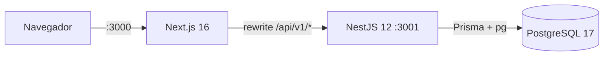
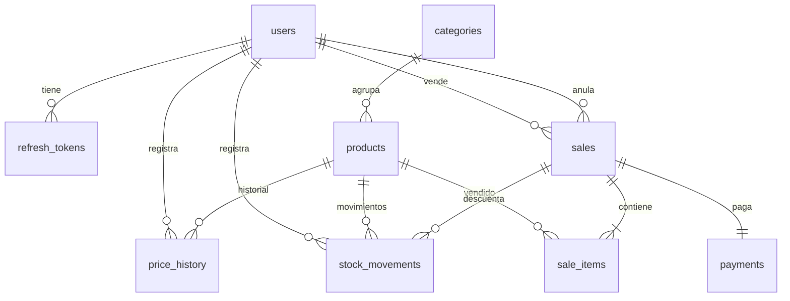

# POS — Sistema de punto de venta

Monorepo del sistema POS. **Estado actual: Fase 1 (modelo de datos)**. La Fase 0
dejó la infraestructura (contenedores de web, API y base de datos, endpoint de
salud y Swagger). La Fase 1 agrega el modelo de datos completo de Prisma, las
migraciones (incluida la secuencia `sale_number_seq` y los _check constraints_),
las _factories_ con Faker y los seeds base y demo. Todavía no hay endpoints de
negocio ni autenticación.

## Stack

| Componente   | Versión                                                   |
| ------------ | --------------------------------------------------------- |
| Node.js      | 26 (`node:26-bookworm-slim`)                              |
| pnpm         | 12.16.1                                                   |
| NestJS       | 12.4.0 (ESM)                                              |
| Next.js      | 16.4.5 + React 19.3.1                                     |
| Prisma       | 7.10.1 + `@prisma/adapter-pg`                             |
| Faker        | 10.6.0 (`@faker-js/faker`, factories y seeds)             |
| tsx          | 4.23.15 (ejecuta los seeds en TypeScript)                 |
| bcryptjs     | 3.0.3 (hash del usuario administrador)                    |
| PostgreSQL   | 17 (alpine)                                               |
| TypeScript   | 5.9.3                                                     |
| Tailwind CSS | 4.3.5                                                     |
| Tests        | Jest 30 + ts-jest (API), Vitest 5 + Testing Library (web) |

## Requisitos

- Docker Engine 29+ con Docker Compose v2/v5.
- `make` (opcional, pero recomendado: encapsula todos los comandos).

No se necesita Node.js ni pnpm en el host: todo se ejecuta dentro de contenedores.

## Estructura

```
.
├── apps/
│   ├── api/            # NestJS 12 (ESM) + Prisma 7 + Swagger
│   │   ├── prisma/     # schema, migraciones, factories y seeds
│   │   │   ├── migrations/  # SQL versionado (init + sale_number_seq)
│   │   │   ├── factories/   # builders puros + create* con Prisma
│   │   │   ├── seed.ts      # seed base idempotente
│   │   │   └── seed-demo.ts # datos de demostración
│   │   ├── src/
│   │   │   ├── config/ # validación de variables de entorno
│   │   │   ├── health/ # GET /api/v1/health
│   │   │   └── prisma/ # PrismaService con adaptador pg
│   │   └── test/       # unitarios y e2e con Supertest
│   └── web/            # Next.js 16 (App Router) + Tailwind 4
│       └── src/
│           ├── app/        # layout, page y tokens M3 (globals.css)
│           ├── components/ # AppShell (top app bar + navegación)
│           └── lib/        # apiFetch
├── infra/postgres/     # init.sql (crea pos_test)
├── docker-compose.yml  # db + api + web en la red pos-net
└── Makefile
```

## Puesta en marcha

```bash
cp .env.example .env      # opcional: docker-compose tiene valores por defecto
make up                   # docker compose up -d --build
make ps                   # estado de los servicios
make logs                 # logs en vivo
```

Servicios resultantes:

| Servicio   | URL                                                     |
| ---------- | ------------------------------------------------------- |
| Web        | http://localhost:3000                                   |
| API        | http://localhost:3001/api/v1                            |
| Swagger    | http://localhost:3001/api/docs                          |
| PostgreSQL | `localhost:5432` (base `pos`, base de tests `pos_test`) |

No se usan bind mounts: el código vive dentro de las imágenes. Después de cambiar
código hay que reconstruir (`make build` o `docker compose up -d --build`).

## Arquitectura de la fase 0



- **web**: shell mínimo Material You (top app bar, navegación lateral, superficies
  tonales). El rewrite de `next.config.ts` envía `/api/v1/:path*` a
  `API_INTERNAL_URL` (por defecto `http://api:3001`), por lo que el navegador
  siempre habla con un único origen.
- **api**: prefijo global `/api/v1`, `ValidationPipe` global, `helmet`,
  `cookie-parser`, Swagger en `/api/docs`.
- **db**: volumen `pgdata`; `infra/postgres/init.sql` crea la base `pos_test` que
  consumen las pruebas e2e.

## Endpoint de salud

`GET /api/v1/health` no requiere autenticación. Responde **200** cuando la base de
datos responde y **503** cuando no.

```json
{
  "status": "ok",
  "database": "up",
  "timestamp": "2026-01-15T12:34:56.789Z"
}
```

Cuando PostgreSQL no responde:

```json
{
  "status": "error",
  "database": "down",
  "timestamp": "2026-01-15T12:34:56.789Z"
}
```

El contenedor `api` usa este endpoint como healthcheck; `web` arranca solo cuando
la API está saludable.

## Modelo de datos (Fase 1)

Prisma modela el dominio en `apps/api/prisma/schema.prisma`. Todas las tablas
viven en `snake_case` vía `@@map`, las claves primarias son UUID y el dinero es
`Decimal(14, 2)`.



| Tabla             | Propósito                                                   |
| ----------------- | ----------------------------------------------------------- |
| `users`           | Usuarios del sistema (`ADMIN` en el MVP) con hash bcrypt    |
| `refresh_tokens`  | Sesiones renovables; se borran en cascada con el usuario    |
| `categories`      | Agrupación de productos                                     |
| `products`        | Catálogo, precios, stock y stock mínimo (borrado lógico)    |
| `price_history`   | Auditoría de cambios de `COST`/`SALE`                       |
| `stock_movements` | Entradas, ventas, ajustes y anulaciones (cantidad firmada)  |
| `sales`           | Cabecera de venta con totales, costo y utilidad             |
| `sale_items`      | Líneas con precio y costo congelados al momento de la venta |
| `payments`        | Pago único por venta (`CASH`/`CARD`) con efectivo y cambio  |

Enums: `Role { ADMIN, CASHIER }`, `PriceField { COST, SALE }`,
`StockMovementType { ENTRY, SALE, ADJUSTMENT, VOID }`,
`SaleStatus { COMPLETED, VOIDED }` y `PaymentMethod { CASH, CARD }`.

### Migraciones

| Migración                        | Contenido                                                   |
| -------------------------------- | ----------------------------------------------------------- |
| `20261107014248_init`            | Todas las tablas, índices, FKs y _check constraints_        |
| `20261107014300_sale_number_seq` | Secuencia `sale_number_seq START 1` para el número de venta |

Los _check constraints_ aplicados en SQL son: `products.stock >= 0`,
`products."costPrice" >= 0`, `products."salePrice" >= 0`,
`sale_items.quantity > 0` y `sales.total >= 0`.

`sales.number` **no** es autoincremental: la Fase 5 tomará el valor de
`nextval('sale_number_seq')` dentro de la transacción de la venta.

### Factories y seeds

`apps/api/prisma/factories` expone _builders_ puros (sin base de datos) y
funciones `create*` que reciben un `PrismaClient`:

- Builders: `buildUser`, `buildCategory`, `buildProduct`, `buildPriceHistory`,
  `buildStockMovement`, `buildSaleItem`, `buildSale` y `buildPayment`.
- Creators: `createUser`, `createCategory`, `createProduct`,
  `createPriceHistory`, `createStockMovement`, `createPayment` y `createSale`.
- `createSale` arma ítems, pago y totales coherentes: IVA del 19 % incluido en
  el precio, descuento prorrateado por línea, costo y utilidad calculados, stock
  descontado sin quedar en negativo y anulación con restauración de stock.

Ambos seeds fijan `faker.seed(2026)`, por lo que los datos son reproducibles:

| Seed | Comando          | Contenido                                                                                             |
| ---- | ---------------- | ----------------------------------------------------------------------------------------------------- |
| Base | `pnpm seed`      | Upsert del admin, 6 categorías y 12 productos (sin ventas)                                            |
| Demo | `pnpm seed:demo` | Vacía el negocio y crea 30 productos, 40 ventas de 30 días, 6 anuladas, mermas e historial de precios |

## Comandos

| Comando                                     | Descripción                                      |
| ------------------------------------------- | ------------------------------------------------ |
| `make up`                                   | Construye y levanta `db`, `api` y `web`          |
| `make down`                                 | Detiene los contenedores (conserva el volumen)   |
| `make build`                                | Reconstruye las imágenes                         |
| `make logs` / `make ps`                     | Logs en vivo / estado                            |
| `make migrate`                              | `prisma migrate dev` sobre la base `pos`         |
| `make migrate-deploy`                       | `prisma migrate deploy` (CI/producción)          |
| `make migrate-test`                         | `prisma migrate deploy` sobre `pos_test`         |
| `make seed`                                 | Seed base (`tsx prisma/seed.ts`)                 |
| `make seed-demo`                            | Seed de demostración (`tsx prisma/seed-demo.ts`) |
| `make api-test`                             | Jest unitario de la API                          |
| `make api-e2e`                              | Migra `pos_test` y corre Jest e2e                |
| `make web-test`                             | Vitest de la web                                 |
| `make lint-api` / `make lint-web`           | ESLint                                           |
| `make typecheck-api` / `make typecheck-web` | `tsc --noEmit`                                   |

Los targets de test aceptan `FILE=` para acotar el archivo:

```bash
make api-e2e FILE=health.e2e-spec.ts
make web-test FILE=src/components/app-shell.test.tsx
```

Sin `FILE`, corren todos los archivos del proyecto. `make api-e2e` aplica antes
`prisma migrate deploy` sobre `pos_test` (`make migrate-test`).

## Pruebas de la fase 0

```bash
# 1. Imagen de la API
docker compose build api

# 2. Base de datos saludable
docker compose up -d db

# 3. e2e contra la base de tests
docker compose run --rm \
  -e DATABASE_URL=postgresql://pos:pos@db:5432/pos_test \
  api pnpm test:e2e -- health.e2e-spec.ts

# 4. Imagen de la web
docker compose build web

# 5. Test del shell de la aplicación
docker compose run --rm web pnpm test -- src/components/app-shell.test.tsx

# 6. Humo end-to-end
docker compose up -d api web
curl -f http://localhost:3001/api/v1/health
curl -f http://localhost:3000
```

## Pruebas de la fase 1

```bash
# 1. Imagen con las dependencias nuevas y el cliente Prisma regenerado
docker compose build api

# 2. Base de datos arriba
docker compose up -d db

# 3. Migraciones sobre pos (el directorio prisma se monta para persistir)
docker compose run --rm \
  -v "$PWD/apps/api/prisma:/app/apps/api/prisma" \
  -e DATABASE_URL=postgresql://pos:pos@db:5432/pos \
  api pnpm exec prisma migrate dev

# 4. Migraciones sobre pos_test + e2e del esquema
make migrate-test
make api-e2e FILE=test/schema.e2e-spec.ts

# 5. Unitarios de factories (sin base de datos)
make api-test FILE=test/factories.spec.ts

# 6. Seeds
docker compose run --rm api pnpm seed
docker compose run --rm api pnpm seed:demo

# 7. Conteos del seed demo
docker compose exec db psql -U pos -d pos -c "
SELECT 'users' t, count(*) FROM users UNION ALL
SELECT 'categories', count(*) FROM categories UNION ALL
SELECT 'products', count(*) FROM products UNION ALL
SELECT 'sales', count(*) FROM sales UNION ALL
SELECT 'sale_items', count(*) FROM sale_items UNION ALL
SELECT 'payments', count(*) FROM payments UNION ALL
SELECT 'stock_movements', count(*) FROM stock_movements;"

# 8. Calidad
make typecheck-api
make lint-api
```

## Credenciales

El seed (`pnpm seed` y `pnpm seed:demo`) crea el administrador del MVP:

| Usuario           | Contraseña  | Rol     |
| ----------------- | ----------- | ------- |
| `admin@pos.local` | `Admin123!` | `ADMIN` |

La contraseña se guarda con bcrypt (coste 12) y se restablece en cada corrida
del seed. `JWT_ACCESS_SECRET` y `JWT_REFRESH_SECRET` se validan como opcionales
en `src/config/env.validation.ts` y se usarán en la fase de autenticación.

## Notas técnicas

- **NestJS 12 es ESM**: el paquete declara `"type": "module"`, los imports
  relativos llevan extensión `.js` y el proyecto compila con `module: nodenext`.
- **Prisma 7** genera el cliente con el generator `prisma-client` en
  `apps/api/src/generated/prisma` (ignorado por git, en TypeScript) y requiere un
  _driver adapter_; `PrismaService` usa `PrismaPg`. La URL de la base se lee de
  `prisma.config.ts`, no del `schema.prisma`.
- **Factories y seeds fuera de `src`**: `tsconfig.json` incluye `prisma/**/*.ts`
  para que `typecheck` y ESLint también los cubran; `tsconfig.build.json` sigue
  compilando solo `src`.
- **Seeds con tsx**: `prisma.config.ts` declara `seed: 'tsx prisma/seed.ts'` y
  `tsx` resuelve los imports `.js` de los archivos TypeScript. Las factories
  comparten `prisma/client.ts` (crea el `PrismaClient` con `PrismaPg`) para no
  depender de Nest.
- **Migraciones persistidas**: el directorio `apps/api/prisma` se monta solo al
  generar/aplicar migraciones; el resto del código vive en la imagen, así que
  cualquier cambio exige `docker compose build api`.
- **Jest en ESM** requiere `NODE_OPTIONS=--experimental-vm-modules`; los scripts
  `test` y `test:e2e` ya lo incluyen.
- **Tailwind 4** define los tokens Material You con `@theme inline` sobre
  variables CSS, por lo que el modo oscuro funciona con `prefers-color-scheme`
  sin prefijos `dark:`.
