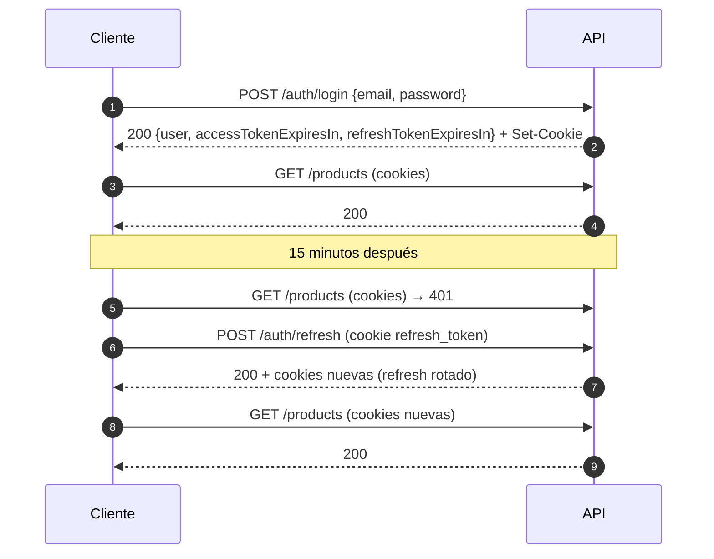

# API — POS v1.0.0

> **Propósito:** documentar cómo se autentica, cómo responde cuando falla, cómo pagina y qué rutas expone cada módulo. Todas las rutas, cookies, códigos y formatos de este documento están verificados contra `apps/api/src/` y contra la API en ejecución.
>
> **Fuente viva del contrato:** Swagger UI en `http://localhost:3001/api/docs` y su JSON en `http://localhost:3001/api/docs/json` (versión **1.0.0**). Ahí está cada parámetro y cada respuesta de error; este documento es el mapa.
>
> **Documentos relacionados:** [Arquitectura](ARQUITECTURA.md) · [Modelo de datos](MODELO-DATOS.md) · [Decisiones](DECISIONES.md) · [README](../README.md)

## Índice

- [Base y convenciones](#base-y-convenciones)
- [Autenticación por cookies](#autenticación-por-cookies)
- [Formato de error](#formato-de-error)
- [Paginación](#paginación)
- [Límites de peticiones](#límites-de-peticiones)
- [Endpoints por módulo](#endpoints-por-módulo)
- [Ejemplos `curl`](#ejemplos-curl)

## Base y convenciones

| Aspecto        | Valor verificado                                                                              |
| :------------- | :-------------------------------------------------------------------------------------------- |
| Prefijo global | `/api/v1` (`GLOBAL_PREFIX` en `apps/api/src/app.setup.ts`)                                     |
| Swagger UI     | `http://localhost:3001/api/docs`                                                               |
| Swagger JSON   | `http://localhost:3001/api/docs/json` (`jsonDocumentUrl`)                                      |
| Versión        | `1.0.0` (`setVersion('1.0.0')` en `apps/api/src/main.ts`)                                       |
| Content-Type   | `application/json`                                                                             |
| Moneda         | COP, con dos decimales en las respuestas numéricas                                             |
| Fechas         | ISO 8601 en UTC (las agrupaciones del dashboard se leen en `America/Bogota`)                    |
| Errores        | Forma uniforme con `statusCode`, `message`, `error`, `timestamp` y `path`                       |
| Swagger-auth   | `addCookieAuth` para `access_token` y `refresh_token`                                          |

Colecciones de rutas registradas en Swagger (27 rutas):

```text
/api/v1/health
/api/v1/auth/login            /api/v1/auth/refresh   /api/v1/auth/logout   /api/v1/auth/me
/api/v1/users                 /api/v1/users/{id}     /api/v1/users/{id}/password   /api/v1/users/{id}/deactivate
/api/v1/categories            /api/v1/categories/{id}
/api/v1/products              /api/v1/products/{id}  /api/v1/products/{id}/price-history
/api/v1/products/{id}/stock-movements
/api/v1/inventory/movements   /api/v1/inventory/low-stock   /api/v1/inventory/summary
/api/v1/sales                 /api/v1/sales/{id}     /api/v1/sales/{id}/receipt    /api/v1/sales/{id}/void
/api/v1/dashboard/summary     /api/v1/dashboard/sales-trend  /api/v1/dashboard/top-products
/api/v1/dashboard/payment-methods   /api/v1/dashboard/low-stock
```

## Autenticación por cookies

La sesión se mantiene con **cookies `httpOnly`**: los tokens **nunca** viajan en el body de la respuesta, así que el JavaScript del navegador no puede leerlos.

| Cookie          | Contenido                                                  | `Path`         | `Max-Age` | Atributos                                          |
| :-------------- | :--------------------------------------------------------- | :------------- | --------: | :-------------------------------------------------- |
| `access_token`  | JWT HS256 (`sub`, `email`, `role`), expira a los 15 minutos | `/`            |   7 días  | `HttpOnly`, `SameSite=Lax`, `Secure` en producción  |
| `refresh_token` | Token opaco de 64 bytes aleatorios (base64url)              | `/api/v1/auth` |   7 días  | `HttpOnly`, `SameSite=Lax`, `Secure` en producción  |

- `POST /auth/login` responde `200` con el usuario y los segundos de vigencia (`accessTokenExpiresIn: 900`, `refreshTokenExpiresIn: 604800`), más `Set-Cookie` con ambas cookies.
- En la base solo se guarda el **HMAC-SHA256** del refresh (con `JWT_REFRESH_SECRET` como _pepper_), junto a `userAgent`, `ip`, `expiresAt` y `revokedAt`.
- El **access token caduca a los 15 minutos** aunque la cookie dure 7 días: al recibir `401` hay que llamar a `POST /auth/refresh` y reintentar. La web ya lo hace con un único refresh en vuelo (`apps/web/src/lib/api-client.ts`).
- `POST /auth/refresh` **rota** el refresh: revoca el recibido y emite uno nuevo. Si llega un refresh ya revocado se interpreta como reuso (robo o _replay_) y se revocan **todas** las sesiones del usuario (`401`).
- Alternativa para clientes sin cookies: `Authorization: Bearer <access token>`. El guard lee primero la cookie `access_token` y, si no existe, ese encabezado.



## Formato de error

`HttpExceptionFilter` (`apps/api/src/common/filters/http-exception.filter.ts`) normaliza **toda** salida de error a esta forma:

| Campo       | Tipo               | Descripción                                                          |
| :---------- | :----------------- | :------------------------------------------------------------------- |
| `statusCode` | `number`          | Código HTTP de la respuesta                                          |
| `message`   | `string \| string[]` | Mensaje, o **lista** de mensajes cuando falla el `ValidationPipe`   |
| `error`     | `string`          | Nombre corto del error HTTP (`Unauthorized`, `Bad Request`, …)        |
| `timestamp` | `string`          | Marca temporal ISO 8601                                              |
| `path`      | `string`          | Ruta de la petición que originó el error                             |

Respuesta real sin sesión (`GET /api/v1/products`):

```json
{
  "statusCode": 401,
  "message": "Se requiere autenticación",
  "error": "Unauthorized",
  "timestamp": "2026-11-07T17:01:45.514Z",
  "path": "/api/v1/products"
}
```

Errores de validación: `message` es un arreglo con el detalle de `class-validator`.

```json
{
  "statusCode": 400,
  "message": ["quantity debe ser un número entero", "unitCost debe ser mayor o igual a 0"],
  "error": "Bad Request",
  "timestamp": "2026-11-07T17:01:45.514Z",
  "path": "/api/v1/inventory/movements"
}
```

Otras reglas del filtro:

- Errores no controlados se responden como `500` con `message: "Error interno del servidor"` y **sin** exponer el stack (queda en el log del servidor).
- Se replican las cabeceras de las `HttpException`: el `429` conserva `Retry-After`.

| Código | Cuándo aparece                                                                          |
| :----- | :--------------------------------------------------------------------------------------- |
| `400`  | Payload o query inválidos, `stock` en el catálogo, descuento mayor al subtotal, `from > to` |
| `401`  | Sin sesión, token inválido/expirado, usuario inactivo, refresh revocado                  |
| `403`  | Rol distinto de `ADMIN` o `Origin` fuera de `WEB_ORIGIN`                                  |
| `404`  | Recurso inexistente o eliminado lógicamente                                               |
| `409`  | Duplicados (email, nombre, SKU, barcode), stock insuficiente, venta ya anulada, categoría con productos activos |
| `429`  | Se superaron 5 intentos de login por minuto e IP                                          |
| `503`  | `GET /health` cuando PostgreSQL no responde                                               |

## Paginación

Los listados devuelven `{ data, meta }` con esta forma (`apps/api/src/common/dto/pagination-meta.dto.ts`):

| Campo             | Tipo      | Descripción                                          |
| :---------------- | :-------- | :--------------------------------------------------- |
| `meta.page`       | `number`  | Página actual (1-based)                              |
| `meta.pageSize`   | `number`  | Elementos por página (`pageSize` máximo: `100`)      |
| `meta.total`      | `number`  | Total de elementos que cumplen el filtro             |
| `meta.totalPages` | `number`  | Total de páginas (`0` cuando no hay resultados)      |
| `meta.hasNextPage`     | `boolean` | Existe página siguiente                          |
| `meta.hasPreviousPage` | `boolean` | Existe página anterior                           |

Ningún `data` devuelve `passwordHash`: los mappers construyen la salida campo por campo.

## Límites de peticiones

`RateLimitGuard` aplica la clave `MÉTODO:ruta:IP` y responde `429` con `Retry-After` y las cabeceras `X-RateLimit-Limit` / `X-RateLimit-Remaining`.

| Ámbito            | Límite               | Fuente                                                        |
| :---------------- | :------------------- | :------------------------------------------------------------ |
| Global            | 600 peticiones/minuto | `DEFAULT_RATE_LIMIT` en `rate-limit.guard.ts`                 |
| `POST /auth/login` | 5 peticiones/minuto   | `@Throttle({ limit: 5, windowMs: 60_000 })` en `auth.controller.ts` |

> **Note:** los contadores viven **en memoria del proceso** (`apps/api/src/common/rate-limit/rate-limit.service.ts`). Con varias instancias habría que compartirlos (ver [DECISIONES](DECISIONES.md)).

## Endpoints por módulo

### Health

| Método | Ruta            | Acceso  | Descripción                                                             |
| :----- | :-------------- | :------ | :----------------------------------------------------------------------- |
| `GET`  | `/api/v1/health` | Público | Ejecuta `SELECT 1`; `200` con `database: up` o `503` con `database: down` |

```json
{ "status": "ok", "database": "up", "timestamp": "2026-11-07T17:01:36.426Z" }
```

### Auth

| Método | Ruta                   | Acceso   | Descripción                                                              |
| :----- | :--------------------- | :------- | :------------------------------------------------------------------------ |
| `POST` | `/api/v1/auth/login`   | Público  | Valida credenciales y emite las cookies de sesión (5 req/min por IP)      |
| `POST` | `/api/v1/auth/refresh` | Cookie   | Rota el refresh token y emite cookies nuevas                              |
| `POST` | `/api/v1/auth/logout`  | Sesión   | Revoca el refresh actual y expira las cookies (`204`)                     |
| `GET`  | `/api/v1/auth/me`      | Sesión   | Usuario autenticado, sin `passwordHash`                                    |

### Users (rol `ADMIN`)

| Método  | Ruta                              | Descripción                                                             |
| :------ | :-------------------------------- | :------------------------------------------------------------------------ |
| `GET`   | `/api/v1/users`                   | Listado paginado (`page`, `pageSize`, `search`, `active`) ordenado por `createdAt desc` |
| `POST`  | `/api/v1/users`                   | Crea un usuario `ADMIN`; email duplicado → `409`                          |
| `PATCH` | `/api/v1/users/{id}`              | Actualiza `name`, `email` y/o `active`; desactivar revoca sus sesiones    |
| `PATCH` | `/api/v1/users/{id}/password`     | Cambia la contraseña y revoca las sesiones del usuario (`204`)             |
| `PATCH` | `/api/v1/users/{id}/deactivate`   | Desactiva la cuenta; no permite autodesactivarse (`400`)                   |

### Categories (rol `ADMIN`)

| Método   | Ruta                       | Descripción                                                                 |
| :------- | :------------------------- | :--------------------------------------------------------------------------- |
| `GET`    | `/api/v1/categories`       | Todas las categorías ordenadas por nombre, con `productCount`; filtros `active`, `search` |
| `POST`   | `/api/v1/categories`       | Crea categoría; nombre único sin distinguir mayúsculas                       |
| `PATCH`  | `/api/v1/categories/{id}`  | Actualiza `name`, `description` y/o `active`                                 |
| `DELETE` | `/api/v1/categories/{id}`  | Borrado lógico (`active: false`); `409` si tiene productos activos            |

### Products (rol `ADMIN`)

| Método   | Ruta                                    | Descripción                                                                                 |
| :------- | :-------------------------------------- | :-------------------------------------------------------------------------------------------- |
| `GET`    | `/api/v1/products`                      | Listado paginado: `search` (nombre, SKU, barcode), `categoryId`, `active`, `lowStock`, `sort` (`name`, `salePrice`, `stock`, `createdAt`), `order` (`asc`, `desc`) |
| `POST`   | `/api/v1/products`                      | Crea producto con **stock `0`** y registra los precios iniciales `COST`/`SALE`               |
| `GET`    | `/api/v1/products/{id}`                 | Detalle con su categoría e indicador `lowStock`                                               |
| `PATCH`  | `/api/v1/products/{id}`                 | Actualiza catálogo/precios; enviar `stock` → `400`; cada cambio de precio deja `PriceHistory` |
| `DELETE` | `/api/v1/products/{id}`                 | Borrado lógico (`active: false`, `deletedAt`); idempotente (`204`)                            |
| `GET`    | `/api/v1/products/{id}/price-history`   | Historial de precios paginado, más reciente primero                                           |

### Inventory (rol `ADMIN`)

| Método | Ruta                                          | Descripción                                                                                     |
| :----- | :-------------------------------------------- | :------------------------------------------------------------------------------------------------ |
| `POST` | `/api/v1/inventory/movements`                 | Movimiento manual `ENTRY` (recalcula costo promedio ponderado) o `ADJUSTMENT` (merma o sobrante)  |
| `GET`  | `/api/v1/inventory/movements`                 | Movimientos paginados (`productId`, `type`, `from`, `to`), más reciente primero                   |
| `GET`  | `/api/v1/inventory/low-stock`                 | Productos activos con `stock <= minStock` (`categoryId`, `search`), del más crítico al menos      |
| `GET`  | `/api/v1/inventory/summary`                   | Valorización: `totalProducts`, `totalUnits`, `inventoryValue`, `lowStockCount`, `outOfStockCount` |
| `GET`  | `/api/v1/products/{id}/stock-movements`       | Historial de stock de un producto paginado (`type` opcional)                                      |

Cuerpo de un movimiento manual:

| Campo       | Tipo                      | Requerido | Reglas                                                                 |
| :---------- | :------------------------ | :-------- | :---------------------------------------------------------------------- |
| `productId` | `uuid v4`                 | Sí        | Debe existir y no estar eliminado                                        |
| `type`      | `ENTRY` \| `ADJUSTMENT`   | Sí        | `SALE` y `VOID` los genera el módulo de ventas: aquí responden `400`      |
| `quantity`  | `int`                     | Sí        | Distinto de `0`; en `ENTRY` debe ser `> 0`; en `ADJUSTMENT` admite negativos |
| `unitCost`  | `number` (2 decimales)    | No        | Solo `ENTRY`; se ignora en `ADJUSTMENT`                                   |
| `reason`    | `string` (máx. 255)       | Sí en `ADJUSTMENT` | Se recorta antes de guardar                                      |

### Sales (rol `ADMIN`)

| Método | Ruta                          | Descripción                                                                     |
| :----- | :---------------------------- | :-------------------------------------------------------------------------------- |
| `POST` | `/api/v1/sales`               | Registra la venta completa en una transacción (cabecera, líneas, pago, stock)      |
| `GET`  | `/api/v1/sales`               | Listado paginado (`status`, `from`, `to`), más reciente primero                    |
| `GET`  | `/api/v1/sales/{id}`          | Detalle con líneas, pago y datos de anulación                                     |
| `GET`  | `/api/v1/sales/{id}/receipt`  | Comprobante imprimible (mismo `SaleDetailDto` del detalle)                        |
| `POST` | `/api/v1/sales/{id}/void`     | Anula la venta, restaura el stock y crea movimientos `VOID`                       |

Cuerpo de la venta:

| Campo            | Tipo                        | Requerido | Reglas                                                                                     |
| :--------------- | :-------------------------- | :-------- | :------------------------------------------------------------------------------------------ |
| `items`          | array de `{productId, quantity}` | Sí   | De 1 a 100, sin repetir producto, `quantity` entero `>= 1`; precio y costo quedan congelados en la línea |
| `discountAmount` | `number` (2 decimales)      | No        | Descuento global en COP, prorrateado entre líneas; no puede superar el subtotal (`400`)      |
| `payment.method` | `CASH` \| `CARD`            | Sí        | `CASH` exige `cashReceived >= total`; `CARD` no admite `cashReceived`                        |
| `payment.cashReceived` | `number` (2 decimales) | Solo `CASH` | Calcula `changeGiven = cashReceived - total`                                            |

### Dashboard (rol `ADMIN`)

Todos aceptan `from` y `to` (ISO 8601, inclusivos; por defecto, últimos 30 días) y responden `400` si `from > to`.

| Método | Ruta                                  | Descripción                                                                      |
| :----- | :------------------------------------ | :--------------------------------------------------------------------------------- |
| `GET`  | `/api/v1/dashboard/summary`           | KPIs del rango + fotografía de inventario                                          |
| `GET`  | `/api/v1/dashboard/sales-trend`       | Serie temporal (`granularity`: `day` por defecto, `week` cae al lunes, `month`)     |
| `GET`  | `/api/v1/dashboard/top-products`      | Top por `sortBy` (`quantity` por defecto, `revenue`, `profit`), `limit` 1 a 50      |
| `GET`  | `/api/v1/dashboard/payment-methods`   | Cobros agrupados por método; siempre devuelve `CASH` y `CARD` en ese orden           |
| `GET`  | `/api/v1/dashboard/low-stock`         | Alertas de stock bajo con `deficit`; `limit` 1 a 100 (por defecto 10)               |

Respuesta real de `GET /api/v1/dashboard/summary` sobre el seed de demostración:

```json
{
  "range": { "from": "2026-10-08T17:01:45.460Z", "to": "2026-11-07T17:01:45.460Z" },
  "totalSales": 985845,
  "grossSales": 999100,
  "netSales": 828441.2,
  "costOfSales": 674400,
  "grossProfit": 154041.2,
  "margin": 18.59,
  "averageTicket": 28995.44,
  "transactionCount": 34,
  "discounts": 13255,
  "shrinkage": 27700,
  "losses": 40955,
  "inventoryValue": 21762900,
  "lowStockCount": 0,
  "outOfStockCount": 0
}
```

> **Note:** el demo genera 40 ventas y 6 quedan anuladas, por eso `transactionCount` es 34: las ventas `VOIDED` se excluyen de los KPIs. Fórmulas en [Modelo de datos](MODELO-DATOS.md).

## Ejemplos `curl`

### 1. Iniciar sesión (cookie jar)

```bash
curl -i -c cookies.txt \
  -H 'Content-Type: application/json' \
  -d '{"email":"admin@pos.local","password":"Admin123!"}' \
  http://localhost:3001/api/v1/auth/login
```

Respuesta real (sin tokens en el body; viajan en `Set-Cookie`):

```json
{
  "user": {
    "id": "1c151a0f-2c00-4a62-9097-1c79aa8f42e8",
    "name": "Administrador POS",
    "email": "admin@pos.local",
    "role": "ADMIN",
    "active": true,
    "createdAt": "2026-11-07T02:16:15.796Z"
  },
  "accessTokenExpiresIn": 900,
  "refreshTokenExpiresIn": 604800
}
```

### 2. Consultar la sesión y refrescarla

```bash
curl -b cookies.txt http://localhost:3001/api/v1/auth/me

# Rota el refresh: reescribe las cookies
curl -i -b cookies.txt -c cookies.txt -X POST http://localhost:3001/api/v1/auth/refresh

# Cierra sesión (204 + cookies expiradas)
curl -i -b cookies.txt -c cookies.txt -X POST http://localhost:3001/api/v1/auth/logout
```

### 3. Entrada de inventario y consulta de existencias

```bash
# Entrada de 24 unidades a 1.900 COP (recalcula el costo promedio ponderado)
curl -b cookies.txt -H 'Content-Type: application/json' \
  -d '{
    "productId": "<uuid-producto>",
    "type": "ENTRY",
    "quantity": 24,
    "unitCost": 1900,
    "reason": "Compra a proveedor DistriColombia"
  }' \
  http://localhost:3001/api/v1/inventory/movements

# Merma: ajuste negativo con motivo obligatorio
curl -b cookies.txt -H 'Content-Type: application/json' \
  -d '{"productId":"<uuid-producto>","type":"ADJUSTMENT","quantity":-3,"reason":"Empaques rotos en bodega"}' \
  http://localhost:3001/api/v1/inventory/movements

# Movimientos y valorización
curl -b cookies.txt 'http://localhost:3001/api/v1/inventory/movements?pageSize=20&type=ENTRY'
curl -b cookies.txt http://localhost:3001/api/v1/inventory/summary
curl -b cookies.txt 'http://localhost:3001/api/v1/products/<uuid-producto>/stock-movements?pageSize=20'
```

Respuesta real de `GET /api/v1/inventory/summary` sobre el seed de demostración:

```json
{
  "totalProducts": 30,
  "totalUnits": 5526,
  "inventoryValue": 21762900,
  "lowStockCount": 0,
  "outOfStockCount": 0,
  "generatedAt": "2026-11-07T17:01:45.435Z"
}
```

### 4. Registrar una venta

```bash
# Venta en efectivo de dos líneas, con vuelto
curl -b cookies.txt -H 'Content-Type: application/json' \
  -d '{
    "items": [
      { "productId": "<uuid-producto-a>", "quantity": 2 },
      { "productId": "<uuid-producto-b>", "quantity": 1 }
    ],
    "discountAmount": 3570,
    "payment": { "method": "CASH", "cashReceived": 40000 }
  }' \
  http://localhost:3001/api/v1/sales

# Venta con tarjeta
curl -b cookies.txt -H 'Content-Type: application/json' \
  -d '{"items":[{"productId":"<uuid-producto-a>","quantity":1}],"payment":{"method":"CARD"}}' \
  http://localhost:3001/api/v1/sales

# Comprobante y anulación (restaura stock)
curl -b cookies.txt http://localhost:3001/api/v1/sales/<uuid-venta>/receipt
curl -b cookies.txt -H 'Content-Type: application/json' \
  -d '{"reason":"Error de digitación del cajero"}' \
  http://localhost:3001/api/v1/sales/<uuid-venta>/void
```

### 5. Consultar ventas y KPIs

```bash
# Listado paginado: respuesta real del seed demo
curl -b cookies.txt 'http://localhost:3001/api/v1/sales?pageSize=1&status=COMPLETED'
```

```json
{
  "data": [
    {
      "id": "0f410424-d7e2-4ecf-b45b-c7be13205cd5",
      "number": "V-000031",
      "status": "COMPLETED",
      "total": 24200,
      "itemCount": 3,
      "paymentMethod": "CASH",
      "createdAt": "2026-11-07T16:30:00.000Z",
      "voidedAt": null,
      "user": {
        "id": "1c151a0f-2c00-4a62-9097-1c79aa8f42e8",
        "name": "Administrador POS",
        "email": "admin@pos.local"
      }
    }
  ],
  "meta": {
    "page": 1,
    "pageSize": 1,
    "total": 40,
    "totalPages": 40,
    "hasNextPage": true,
    "hasPreviousPage": false
  }
}
```

```bash
curl -b cookies.txt 'http://localhost:3001/api/v1/dashboard/summary?from=2026-10-01T00:00:00.000Z&to=2026-11-01T00:00:00.000Z'
curl -b cookies.txt 'http://localhost:3001/api/v1/dashboard/sales-trend?granularity=week'
curl -b cookies.txt 'http://localhost:3001/api/v1/dashboard/top-products?sortBy=revenue&limit=10'
curl -b cookies.txt 'http://localhost:3001/api/v1/dashboard/payment-methods'
curl -b cookies.txt 'http://localhost:3001/api/v1/dashboard/low-stock?limit=10'
```

> **Warning:** los ejemplos de escritura (venta o movimiento) modifican datos. Ejecútalos contra el entorno de desarrollo o después de un `make reset` / `make seed-demo`.

### 6. Probar mutaciones desde Swagger UI

Swagger UI se sirve en `http://localhost:3001`; como `OriginGuard` valida `Origin` en las mutaciones, hay que incluir ese origen en `WEB_ORIGIN` para probar `POST`/`PATCH`/`DELETE` desde ahí:

```bash
WEB_ORIGIN=http://localhost:3000,http://localhost:3001
```

Con `curl` (sin cabecera `Origin`) las mutaciones pasan sin ajustes.

---

## Enlaces

- [Arquitectura](ARQUITECTURA.md) — guards, pipeline y capas.
- [Modelo de datos](MODELO-DATOS.md) — entidades y fórmulas que respaldan estos contratos.
- [Decisiones](DECISIONES.md) — JWT propio, cookies `httpOnly` y rate limit en memoria.
- [Capturas](CAPTURAS/README.md) — las pantallas que consumen estos endpoints.
- [README](../README.md) — puesta en marcha y credenciales.

## Etiquetas

#api #rest #swagger #nestjs #autenticacion #pos
