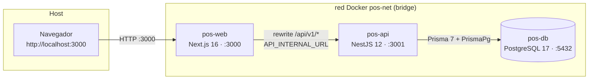
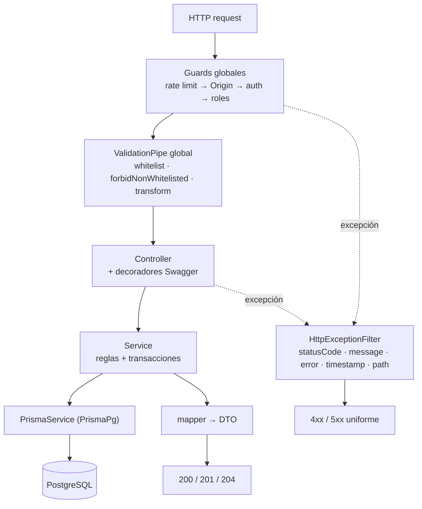
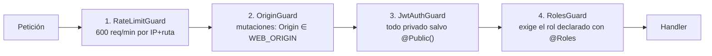
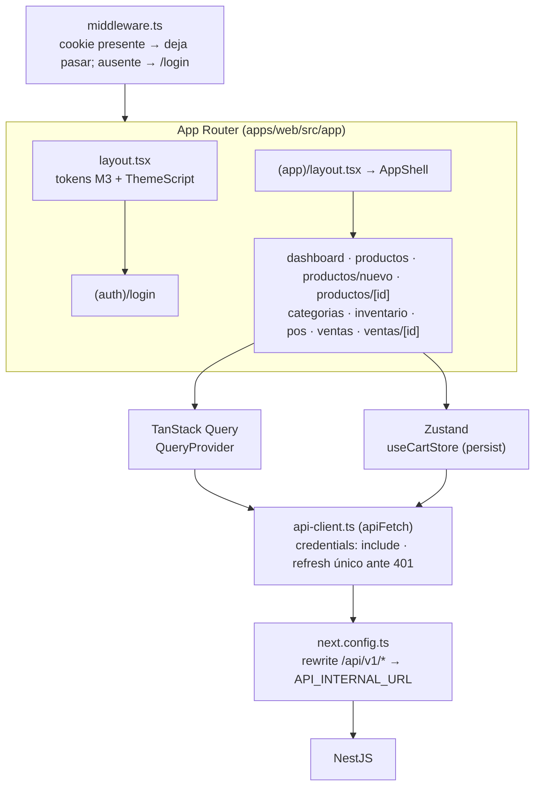
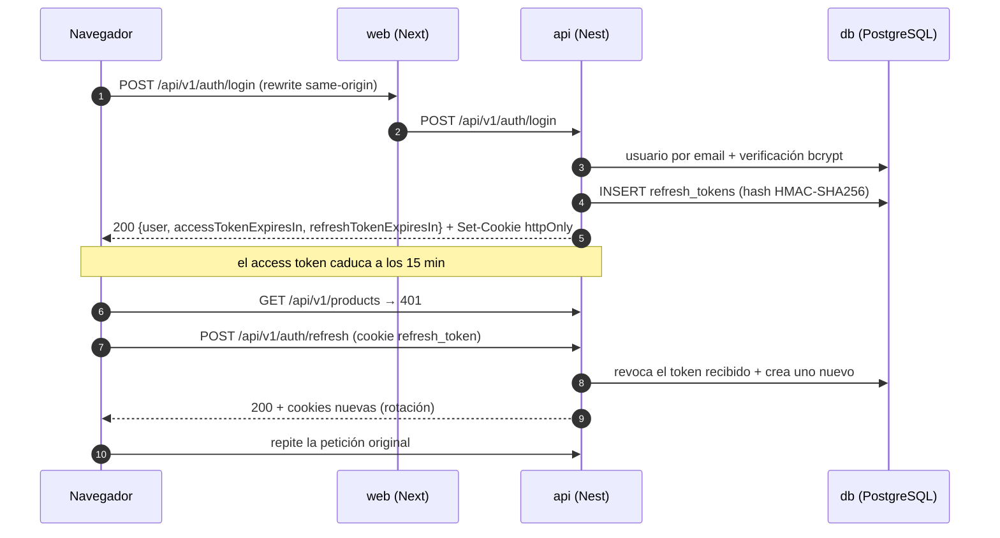
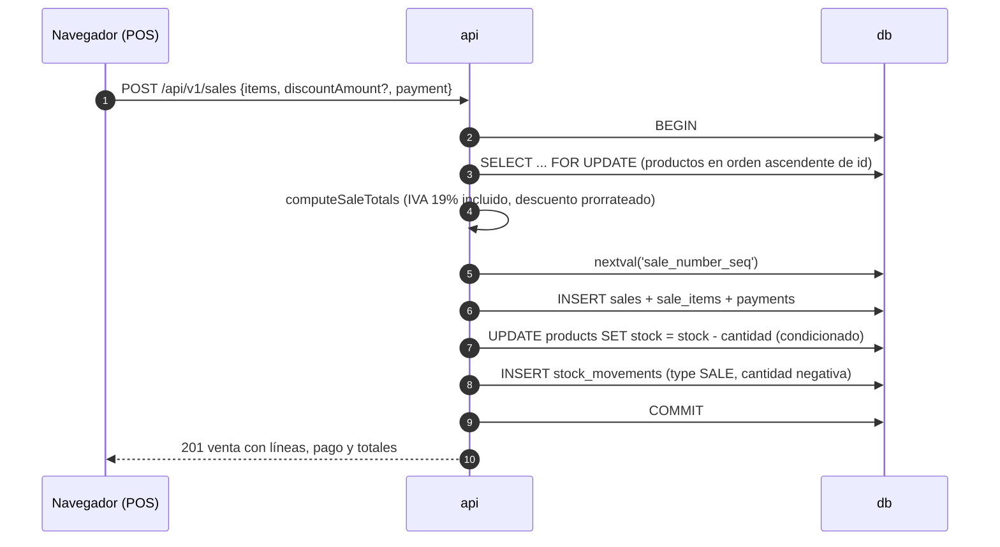

# Arquitectura — POS

> **Propósito:** describir cómo está montado el monorepo, las capas de la API, el orden de los guards, la arquitectura de la web y el flujo real de datos entre contenedores. Todo lo aquí escrito refleja el código en `apps/`, `infra/`, `docker-compose.yml` y `Makefile` en la versión **v1.0.0**.
>
> **Documentos relacionados:** [API](API.md) · [Modelo de datos](MODELO-DATOS.md) · [Decisiones](DECISIONES.md) · [Capturas](CAPTURAS/README.md) · [README](../README.md)

## Índice

- [Vista general](#vista-general)
- [Monorepo](#monorepo)
- [API: capas](#api-capas)
- [Pipeline global de peticiones](#pipeline-global-de-peticiones)
- [Guards globales](#guards-globales)
- [Módulos de la API](#módulos-de-la-api)
- [Arquitectura de la web](#arquitectura-de-la-web)
- [Flujo de datos](#flujo-de-datos)
- [Docker, red y healthchecks](#docker-red-y-healthchecks)
- [Integración continua](#integración-continua)

## Vista general



- El navegador **solo conoce el origen de la web**. `apps/web/next.config.ts` reescribe `/api/v1/:path*` hacia `API_INTERNAL_URL` (por defecto `http://api:3001`), así que las cookies de sesión viajan siempre al mismo origen.
- La API expone el prefijo global `/api/v1` (`GLOBAL_PREFIX` en `apps/api/src/app.setup.ts`) y Swagger en `/api/docs` (`jsonDocumentUrl: /api/docs/json`).
- PostgreSQL es el único almacén de estado: no hay caché externa, colas, WebSockets ni SSE (ver [DECISIONES](DECISIONES.md)).

## Monorepo

pnpm workspace con `packages: apps/*` y `nodeLinker: hoisted`; el layout plano permite copiar `node_modules` tal cual dentro de las imágenes.

```text
.
├── apps/
│   ├── api/                        # @pos/api — NestJS 12 (ESM) + Prisma 7 + Swagger
│   │   ├── prisma/                 # schema, migraciones, factories y seeds
│   │   │   ├── migrations/         # init, sale_number_seq, perf_indexes
│   │   │   ├── factories/          # builders puros + create* con Prisma
│   │   │   ├── seed.ts             # seed base idempotente
│   │   │   ├── seed-demo.ts        # datos de demostración
│   │   │   ├── truncate.ts         # TRUNCATE del negocio + reinicio de la secuencia
│   │   │   └── client.ts           # PrismaClient con PrismaPg (sin Nest)
│   │   ├── src/
│   │   │   ├── main.ts             # bootstrap + Swagger
│   │   │   ├── app.module.ts       # módulos, filtro global y guards
│   │   │   ├── app.setup.ts        # configuración compartida con los e2e
│   │   │   ├── common/             # guards, filtro, rate limit, cookies, decoradores, DTOs
│   │   │   ├── config/             # validación de env y orígenes permitidos
│   │   │   ├── health/             # GET /api/v1/health (público)
│   │   │   ├── modules/            # auth, users, categories, products, inventory, sales, dashboard
│   │   │   └── prisma/             # PrismaService (PrismaPg) y PrismaModule
│   │   ├── test/                   # e2e con Supertest + helpers de sesión y base
│   │   └── Dockerfile
│   └── web/                        # @pos/web — Next.js 16 (App Router) + Tailwind 4
│       ├── src/
│       │   ├── app/                # rutas, layout raíz y tokens M3 (globals.css)
│       │   ├── components/         # UI, layout, y componentes por dominio
│       │   ├── lib/                # api-client, session, dominio y formato
│       │   ├── stores/             # Zustand (carrito)
│       │   └── middleware.ts       # protección de rutas por presencia de cookie
│       ├── test/setup.ts
│       └── Dockerfile
├── infra/postgres/init.sql         # crea la base pos_test
├── scripts/smoke.sh                # humo: health, login y lecturas reales
├── .github/workflows/ci.yml        # lint, typecheck, unit, e2e, build
├── docker-compose.yml              # db + api + web en la red pos-net
├── pnpm-workspace.yaml             # hoisted, allowBuilds, overrides de TypeScript
├── .env.example                    # variables con valores solo de desarrollo
└── Makefile                        # interfaz única de operación
```

> **Note:** el cliente Prisma se genera en `apps/api/src/generated/prisma` (ignorado por git) y `prisma.config.ts` es la fuente de la URL de la base y del comando de seed. Ver [Modelo de datos](MODELO-DATOS.md).

## API: capas

| Capa                    | Ubicación                                             | Responsabilidad                                                        |
| :---------------------- | :---------------------------------------------------- | :--------------------------------------------------------------------- |
| Modelo                  | `apps/api/prisma/schema.prisma`                       | Tablas, enums, índices y relaciones (fuente de las migraciones)         |
| Acceso a datos          | `apps/api/src/prisma/prisma.service.ts`               | `PrismaClient` con driver adapter `PrismaPg`                            |
| Entrada HTTP            | `apps/api/src/modules/*/*.controller.ts`              | Rutas, decoradores Swagger, `@Roles`, `@Public`, `@Throttle`            |
| Negocio                 | `apps/api/src/modules/*/*.service.ts`                 | Reglas, transacciones y traducción de errores de Prisma                 |
| Cálculo puro            | `apps/api/src/modules/sales/sales.calculator.ts`      | IVA, descuento prorrateado, costo y ganancia en centavos enteros        |
| Salida (View)           | `apps/api/src/modules/*/dto/*` + `*.mapper.ts`        | Forma exacta del JSON y documentos de Swagger                           |
| Infraestructura común   | `apps/api/src/common/`, `apps/api/src/config/`        | Guards, filtro de excepciones, rate limit, cookies, validación de env   |

No existe capa _repository_: los services consumen `PrismaService` directamente.



## Pipeline global de peticiones

`configureApp()` (`apps/api/src/app.setup.ts`) aplica la misma configuración en `main.ts` y en las pruebas e2e, en este orden:

| Paso | Configuración                       | Detalle                                                                                            |
| :--- | :---------------------------------- | :------------------------------------------------------------------------------------------------- |
| 1    | `app.setGlobalPrefix('api/v1')`     | Todas las rutas cuelgan de `/api/v1`. Swagger queda fuera (`/api/docs`).                            |
| 2    | `helmet`                            | Cabeceras de seguridad con `contentSecurityPolicy: false` y `crossOriginEmbedderPolicy: false` (Swagger UI usa estilos y scripts inline). |
| 3    | `cookieParser()`                    | Habilita `request.cookies` para los guards y el módulo de auth.                                     |
| 4    | `enableCors`                        | `origin: webOrigins(config)`, `credentials: true`, métodos y `allowedHeaders: Content-Type, Authorization`, `maxAge: 600`. |
| 5    | `ValidationPipe`                    | `whitelist`, `forbidNonWhitelisted`, `transform` y `enableImplicitConversion`.                       |
| 6    | `HttpExceptionFilter` (`APP_FILTER`) | Normaliza toda salida de error y replica cabeceras como `Retry-After`.                              |

## Guards globales

Se registran con `APP_GUARD` en `apps/api/src/app.module.ts`. **El orden importa**:



| # | Guard            | Archivo                                          | Comportamiento verificado                                                                                     |
| :- | :--------------- | :----------------------------------------------- | :------------------------------------------------------------------------------------------------------------ |
| 1 | `RateLimitGuard` | `apps/api/src/common/guards/rate-limit.guard.ts` | Clave `MÉTODO:ruta:IP`, límite global 600 req/min; `@Throttle` lo sobrescribe; responde `429` con `Retry-After` y cabeceras `X-RateLimit-Limit` / `X-RateLimit-Remaining`. |
| 2 | `OriginGuard`    | `apps/api/src/common/guards/origin.guard.ts`     | Solo en `POST`, `PUT`, `PATCH` y `DELETE`; sin cabecera `Origin` (curl, tests, server-to-server) deja pasar; con `Origin` fuera de `WEB_ORIGIN` responde `403`. |
| 3 | `JwtAuthGuard`   | `apps/api/src/common/guards/jwt-auth.guard.ts`   | Todo es privado salvo `@Public()`; lee la cookie `access_token` y, si no existe, `Authorization: Bearer`; valida firma HS256 y `exp`. |
| 4 | `RolesGuard`     | `apps/api/src/common/guards/roles.guard.ts`      | Si el handler o la clase declaran `@Roles(...)`, exige que el rol del usuario esté incluido.                    |

Rutas públicas: `GET /api/v1/health`, `POST /api/v1/auth/login` y `POST /api/v1/auth/refresh` (este último protegido por la cookie de refresh, no por access token).

## Módulos de la API

| Módulo         | Prefijo de ruta | Ruta de código                           | Rol exigido | Contenido verificado                                                                  |
| :------------- | :-------------- | :--------------------------------------- | :---------- | :------------------------------------------------------------------------------------ |
| Health         | `/health`       | `apps/api/src/health/`                   | Público     | `GET /health`: `SELECT 1` contra PostgreSQL; `200`/`503` con `{status,database,timestamp}`. |
| Auth           | `/auth`         | `apps/api/src/modules/auth/`             | Público/sesión | `login`, `refresh`, `logout`, `me`; `JwtService` propio, `TokenService` (emisión, rotación y revocación) y `auth-cookies.ts`. |
| Users          | `/users`        | `apps/api/src/modules/users/`            | `ADMIN`     | Listado paginado, alta, actualización, cambio de contraseña y desactivación.            |
| Categories     | `/categories`   | `apps/api/src/modules/categories/`       | `ADMIN`     | Listado con `productCount`, alta, actualización y borrado lógico.                       |
| Products       | `/products`     | `apps/api/src/modules/products/`         | `ADMIN`     | Catálogo paginado, detalle, alta con stock `0`, actualización con historial e historial de precios. |
| Inventory      | `/inventory` y `/products/:id/stock-movements` | `apps/api/src/modules/inventory/` | `ADMIN` | Movimientos manuales, listados, stock bajo y valorización (`InventoryController` + `ProductStockController`). |
| Sales          | `/sales`        | `apps/api/src/modules/sales/`            | `ADMIN`     | Registro transaccional, listado, detalle, comprobante y anulación.                      |
| Dashboard      | `/dashboard`    | `apps/api/src/modules/dashboard/`        | `ADMIN`     | `summary`, `sales-trend`, `top-products`, `payment-methods`, `low-stock`.               |
| Prisma         | —               | `apps/api/src/prisma/`                   | —           | `PrismaService` con `PrismaPg`, expuesto como módulo global.                            |
| Rate limit     | —               | `apps/api/src/common/rate-limit/`        | —           | Contadores en memoria por proceso con `reset()` para las pruebas.                       |

El detalle de rutas, parámetros y respuestas está en [API](API.md) y en Swagger (`http://localhost:3001/api/docs`), que es la fuente viva del contrato.

## Arquitectura de la web



| Pieza                 | Ubicación                                          | Función verificada                                                                                                       |
| :-------------------- | :------------------------------------------------- | :----------------------------------------------------------------------------------------------------------------------- |
| Rutas                 | `apps/web/src/app/`                                | Grupos `(auth)` para `/login` y `(app)` con `AppShell` para el resto; `app/page.tsx` redirige a `/dashboard`.             |
| Protección de rutas   | `apps/web/src/middleware.ts`                       | Decide por **presencia de cookie** (`access_token`/`refresh_token`); la autoridad real sigue siendo el guard de la API. El `matcher` excluye `api`, `_next/static`, `_next/image`, `favicon.ico` y archivos con extensión. |
| Cliente HTTP          | `apps/web/src/lib/api-client.ts`                   | `apiFetch` con `credentials: 'include'`, rutas relativas a `/api/v1` y **un único refresh en vuelo** ante `401` (reintenta una sola vez y no refresca en `/auth/login` ni `/auth/refresh`). |
| Estado remoto         | `apps/web/src/lib/*.ts` + `components/providers/query-provider.tsx` | Hooks de TanStack Query por dominio (`session`, `catalog`, `inventory`, `sales`, `dashboard`); los datos se piden bajo demanda y se invalidan tras cada mutación. |
| Estado del POS        | `apps/web/src/stores/cart-store.ts`                | Zustand con `persist` (`pos-cart`), `partialize` de `items` y `discountAmount`, `skipHydration` y respaldo en memoria durante el SSR. |
| Diseño                | `apps/web/src/app/globals.css`                     | Tokens Material You (semilla `#1a237e`) declarados en `:root`, en `prefers-color-scheme: dark` y en `:root[data-theme]`; expuestos a Tailwind 4 con `@theme inline`. |
| Componentes           | `apps/web/src/components/`                         | `ui/` (primitivas Material You), `layout/app-shell.tsx` (top app bar + navegación), y carpetas por dominio (`auth`, `dashboard`, `inventory`, `pos`, `products`, `sales`, `categories`, `theme`). |

> **Note:** el carrito vive en el navegador; el servidor no guarda borradores de venta. La venta solo existe cuando `POST /api/v1/sales` la registra en una transacción.

## Flujo de datos

### Sesión (login, vigencia y rotación)



### Venta (transacción única)



En la anulación (`POST /api/v1/sales/:id/void`) la misma transacción marca `VOIDED`, **restaura el stock** y crea movimientos `VOID`. Detalle de fórmulas en [Modelo de datos](MODELO-DATOS.md).

## Docker, red y healthchecks

`docker-compose.yml` define `db`, `api` y `web`, la red de usuario `pos-net` (driver `bridge`) y el volumen `pos-pgdata`.

| Servicio | Imagen / build                     | Puerto            | Healthcheck                                                                 | Depende de                              |
| :------- | :--------------------------------- | :---------------- | :-------------------------------------------------------------------------- | :-------------------------------------- |
| `db`     | `postgres:17-alpine`               | `5432`            | `pg_isready -U pos -d pos` (5 s, 12 reintentos, `start_period` 10 s)          | —                                       |
| `api`    | `apps/api/Dockerfile` (`target: dev`) | `3001`         | `fetch http://127.0.0.1:3001/api/v1/health` (10 s, 12 reintentos, `start_period` 40 s) | `db` con `condition: service_healthy`   |
| `web`    | `apps/web/Dockerfile` (`target: dev`) | `3000`         | `fetch http://127.0.0.1:3000` (10 s, 12 reintentos, `start_period` 30 s)      | `api` con `condition: service_healthy`  |

| Aspecto              | Situación verificada                                                                                      |
| :------------------- | :-------------------------------------------------------------------------------------------------------- |
| Bind mounts          | **No hay** (salvo `infra/postgres/init.sql`, montado como `01-init.sql`). El código vive dentro de las imágenes: tras cambiarlo hay que reconstruir (`make build` o `make up`). |
| Migraciones          | El directorio `apps/api/prisma` se monta **solo** en los targets `migrate` y `migrate-test` para persistir el SQL generado. |
| Bases de datos       | `pos` la crea `POSTGRES_DB`; `pos_test` la crea `infra/postgres/init.sql` en el primer arranque del volumen. |
| Volumen de datos     | `pos-pgdata` (nombre fijo). `make test-reset` lo elimina (`docker compose down -v`).                       |
| Imágenes de producción | Stages `prod` en ambos Dockerfile: la API ejecuta `node dist/main.js` y la web sirve la salida `standalone` de Next (`node apps/web/server.js`). |

## Integración continua

`.github/workflows/ci.yml` corre en `push` y `pull_request`, con `concurrency` que cancela ejecuciones previas de la misma referencia y `NODE_OPTIONS=--experimental-vm-modules` global.

| Job         | Pasos principales                                                                                             |
| :---------- | :------------------------------------------------------------------------------------------------------------ |
| `lint`      | `pnpm install --frozen-lockfile` → `prisma:generate` → `pnpm lint`                                             |
| `typecheck` | instalación → `prisma:generate` → `pnpm typecheck`                                                             |
| `test-unit` | instalación → `prisma:generate` → `pnpm test`                                                                  |
| `test-e2e`  | servicio `postgres:17-alpine` con healthcheck → crea `pos_test` → migra `pos` y `pos_test` → `pnpm --filter @pos/api test:e2e` |
| `build`     | `pnpm --filter @pos/api build` y `pnpm --filter @pos/web build`                                                |

---

## Enlaces

- [API](API.md) — endpoints, cookies y ejemplos `curl`.
- [Modelo de datos](MODELO-DATOS.md) — entidades, índices, constraints y fórmulas.
- [Decisiones](DECISIONES.md) — ADRs verificados.
- [Capturas](CAPTURAS/README.md) — galería de pantallas reales.
- [README](../README.md) — puesta en marcha, comandos y pruebas.

## Etiquetas

#arquitectura #monorepo #nestjs #nextjs #docker #pos
