# Evidencias del procedimiento

Este documento acompaña las capturas del trabajo que hicimos en equipo. La idea es contar, en palabras sencillas, qué se ve en cada imagen y qué aprendimos en el camino. Las capturas están en esta misma carpeta.

## 1. Crear el repositorio en GitHub

### Captura 4 — El formulario de creación

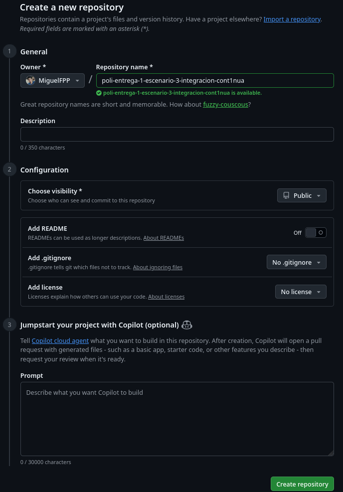

Aquí se ve el momento en que se crea el repositorio en GitHub. Elegimos una de nuestras cuentas como dueña, escribimos el nombre del proyecto y lo dejamos público para que el profesor pueda entrar sin pedir permiso.

No marcamos ninguna casilla de las opciones de abajo. Eso significa que el repositorio nace vacío, sin README, sin archivo de ignorados y sin licencia. Preferimos subir todo desde nuestros computadores para tener el control de lo que entra desde el primer commit.

### Captura 5 — El repositorio ya existe

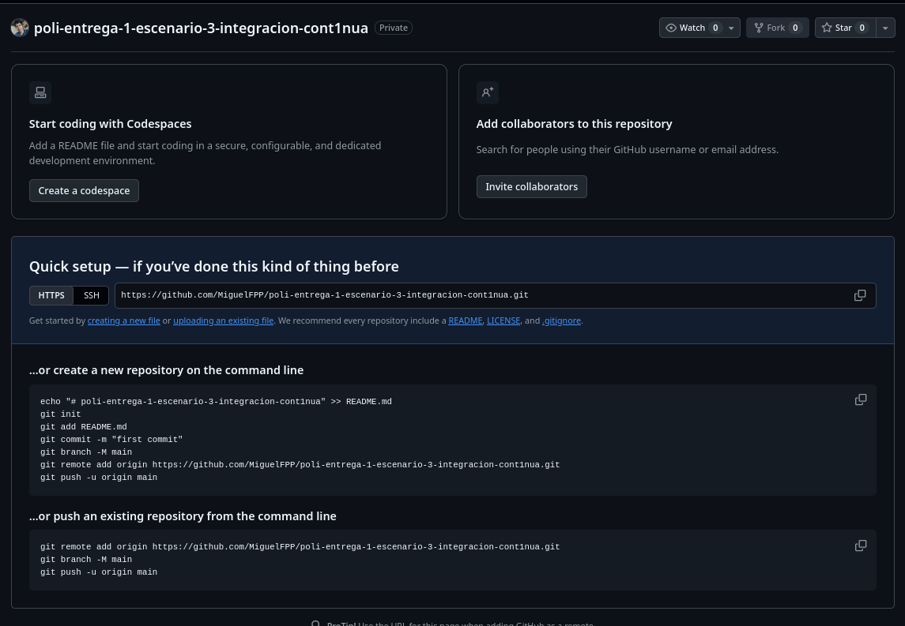

GitHub confirma que el repositorio quedó creado y muestra la dirección del proyecto. Esa dirección es la que después se usa para conectar la carpeta local con la nube.

La página también sugiere los comandos para subir el proyecto. Nos sirvió de guía, aunque igual los ejecutamos a mano para entender qué hacía cada uno. La idea principal es simple: GitHub guarda la copia remota y nuestros computadores guardan la copia local.

### Captura 2 — Iniciar Git en la carpeta

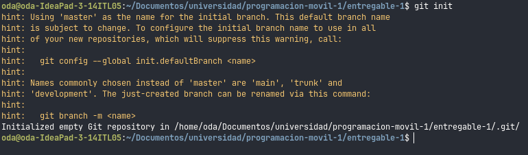

Con `git init` convertimos una carpeta normal en un repositorio. Ahí nace la carpeta oculta `.git`, que es donde Git guarda todo el historial de cambios.

La terminal avisa que la rama inicial se llama `master` y que hoy es más común usar `main`. Ese aviso no es un error, solo una recomendación de configuración. Por eso el paso siguiente fue renombrar la rama principal.

### Captura 3 — Conectar la carpeta con GitHub

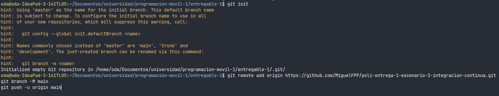

En esta captura están los tres comandos que unen el trabajo local con el repositorio de GitHub. Primero se agrega el origen remoto con `git remote add origin`, que es como decirle a Git «la copia oficial está allá».

Después, `git branch -M main` renombra la rama principal. Por último, `git push -u origin main` empuja los archivos y deja la rama local siguiendo a la remota. El `-u` solo se usa la primera vez y evita escribir el destino en cada envío.

## 2. Las recetas de los contenedores

### Captura 6 — Los dos Dockerfiles

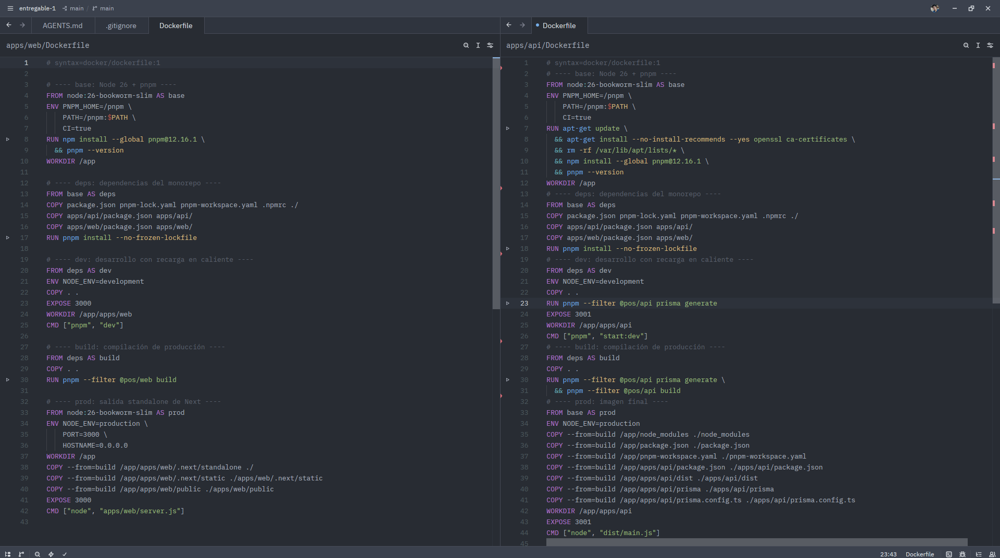

Aquí se ven los dos archivos que funcionan como receta para construir cada imagen. El de la izquierda es el de la web y el de la derecha es el de la API. Cada uno parte de Node 26 y le instala pnpm.

La parte importante es que están divididos por etapas. Primero se instalan las dependencias, después se prepara el modo de desarrollo y al final se arma la versión de producción. Esa división hace que Docker pueda reutilizar lo que no cambió y no repita todo el trabajo.

En la API aparece un paso extra con `prisma generate`. Es necesario porque el cliente de la base de datos no se guarda en el repositorio, se genera dentro de la imagen.

### Captura 7 — El archivo que une las piezas

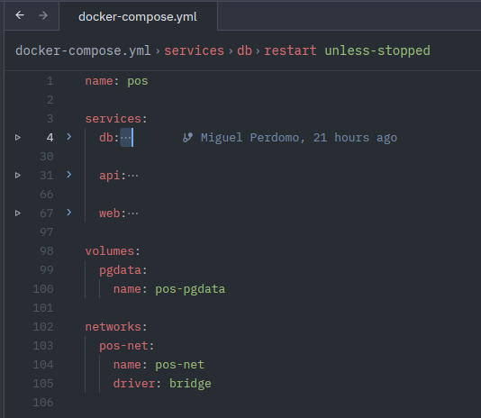

Este es el archivo principal de la práctica. Arriba están los tres servicios, y abajo se declaran el volumen y la red. El volumen se llama `pos-pgdata` y la red se llama `pos-net`.

Los nombres propios son clave. El volumen guarda los datos aunque se borren los contenedores, y la red permite que los servicios se hablen entre ellos usando su nombre en vez de una dirección IP.

### Captura 8 — El servicio de la base de datos

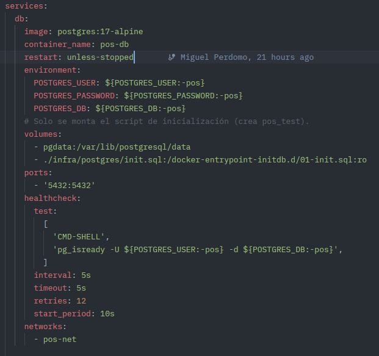

La base de datos usa la imagen oficial de PostgreSQL 17. Tiene su propio nombre de contenedor, sus credenciales y el volumen donde se guarda la información de verdad.

El puerto `5432` se publica hacia afuera para poder entrar con `psql` desde el computador. El `healthcheck` hace una revisión con `pg_isready`: si la base no contesta, Docker lo sabe y no deja arrancar a la API.

También se monta un pequeño script de inicio que crea la base de pruebas. Ese script solo corre la primera vez, cuando el volumen todavía está vacío.

Las piezas del servicio, en simple:

- **`environment`**: los datos de acceso de la base (usuario, contraseña y nombre).
- **`depends_on`**: no lo usa, porque es la primera pieza de la cadena y no espera a nadie.
- **`restart: unless-stopped`**: si el contenedor se cae, Docker lo vuelve a levantar; solo queda apagado si lo paramos a propósito.
- **`test` con `pg_isready`**: la pregunta que Docker hace para saber si la base ya responde.
- **`retries: 12`**: cuántas veces insiste con esa pregunta antes de marcarla con problemas.

Los tiempos (`interval`, `timeout` y `start_period`) solo dicen cada cuánto preguntar y cuánto esperar. No hacen falta para entender el funcionamiento.

### Captura 9 — El servicio de la API

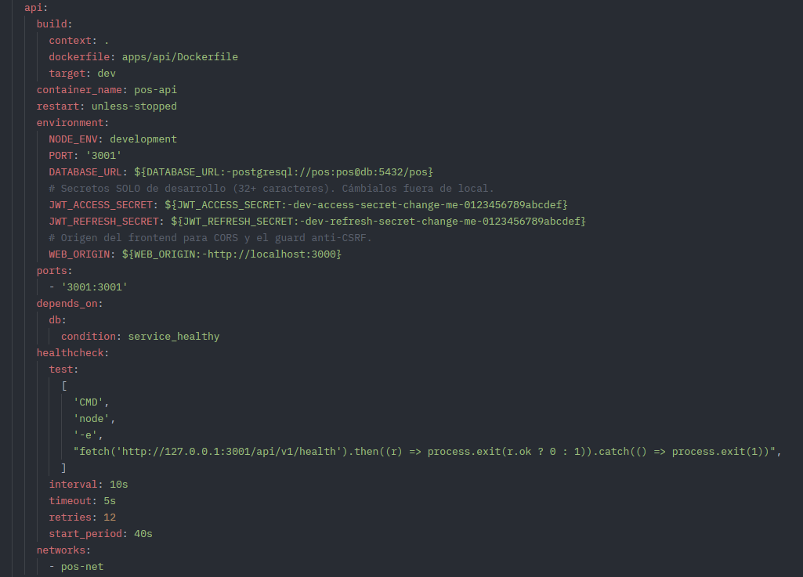

La API se construye con su propio Dockerfile y arranca en el puerto `3001`. La línea más importante es `DATABASE_URL`, porque apunta a `db:5432`. Ahí se ve la magia de la red: `db` es el nombre del otro contenedor, no una dirección inventada.

Abajo aparece `depends_on` con la condición `service_healthy`. Eso significa que la API espera a que la base esté sana antes de arrancar, y evita el error típico de «no encuentro la base de datos».

Su `healthcheck` llama a `/api/v1/health`. Esa ruta hace una consulta de prueba a PostgreSQL, así que si la API aparece sana es porque de verdad llegó a la base.

Las piezas del servicio, en simple:

- **`environment`**: la dirección de la base (`db:5432`), los secretos de la sesión y el origen permitido del front.
- **`depends_on`**: no arranca hasta que la base pase su chequeo.
- **`restart: unless-stopped`**: se levanta solo si se cae.
- **`test` con `fetch` a `/api/v1/health`**: pregunta si la API responde y si la base contesta.
- **`retries: 12`**: cantidad de intentos antes de darla por caída.

### Captura 10 — El servicio de la web

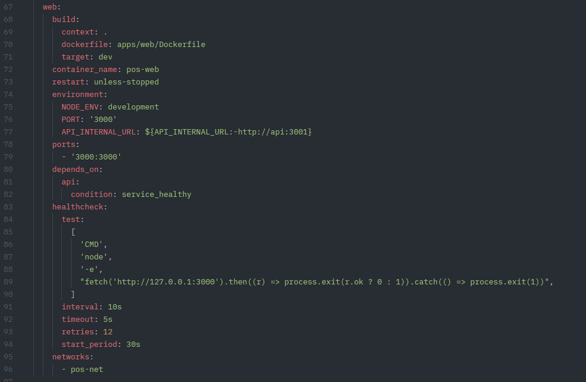

La web también se construye con su Dockerfile y escucha en el puerto `3000`. Su variable `API_INTERNAL_URL` apunta a `http://api:3001`, que es la dirección de la API dentro de la red.

Igual que la API, espera a que el servicio anterior esté sano. El `healthcheck` consulta su propia raíz, así que confirma que Next está respondiendo.

Un detalle que vale la pena resaltar: la web nunca habla con la base de datos. Solo habla con la API, y la API es la que consulta a PostgreSQL.

Las piezas del servicio, en simple:

- **`environment`**: `API_INTERNAL_URL`, que es la dirección de la API dentro de la red.
- **`depends_on`**: espera a que la API esté sana antes de arrancar.
- **`restart: unless-stopped`**: vuelve a arrancar si se cae.
- **`test` con `fetch` a su portada**: confirma que Next está sirviendo páginas.
- **`retries: 12`**: intentos antes de marcarla con problemas.

## 3. Levantar el sistema

### Captura 11 — La construcción y el arranque

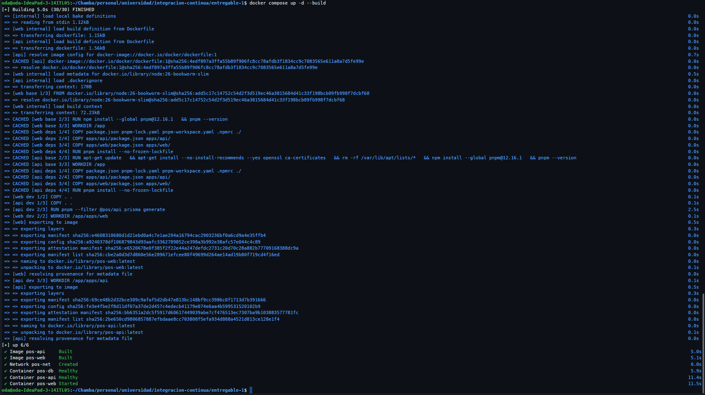

Este comando hace todo de una vez: construye las imágenes, crea la red y levanta los tres contenedores. La terminal va mostrando cada paso hasta terminar.

Se ven las etapas `CACHED` en varias líneas. Eso quiere decir que Docker reutilizó partes que ya estaban construidas, y por eso el proceso fue más rápido.

Al final aparecen los contenedores. La base y la API quedaron saludables, y la web terminó de arrancar. La red `pos-net` también se creó en ese momento.

## 4. Revisar que todo esté arriba

### Captura 12 — El estado de los servicios

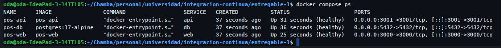

Con `docker compose ps` se confirma que los tres contenedores están corriendo. Los tres aparecen como `healthy`, que es el estado que pone Docker cuando el chequeo automático responde bien.

También se ven los puertos. El `3000` es la web, el `3001` es la API y el `5432` es la base de datos. El formato `0.0.0.0:3000->3000` significa que el puerto del computador se conecta con el puerto del contenedor.

Esta captura es la prueba rápida de que el sistema está completo. Si alguno estuviera en rojo o reiniciándose, aquí se notaría de inmediato.

### Captura 13 — Los registros en vivo

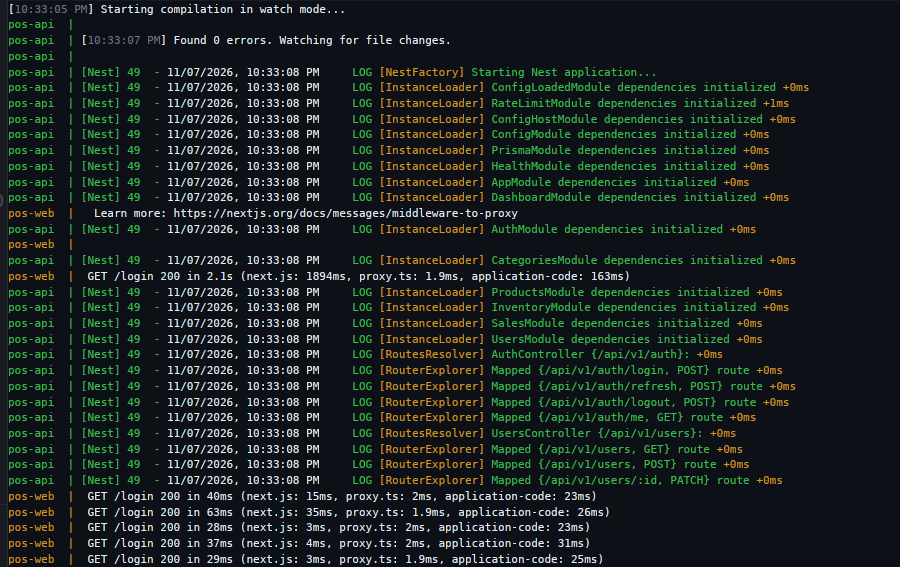

Aquí se ven los mensajes de los contenedores mientras trabajan. La API muestra que Nest arrancó sin errores y que registró todas sus rutas, una por una, bajo `/api/v1`.

También aparece la web respondiendo `GET /login` con código `200`. Ese código significa que la página cargó bien. Esa es la prueba de que la web está sirviendo contenido real y no solo está prendida.

Los logs son la herramienta más útil cuando algo falla. Ahí se ve el error exacto, el módulo que lo produjo y el momento en que pasó.

## 5. Comprobar la comunicación

### Captura 14 — Redes, volúmenes y direcciones

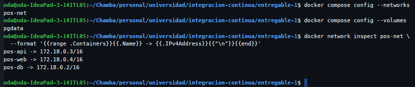

Esta es la captura más importante para la actividad. Primero se confirma que la red se llama `pos-net` y que el volumen se llama `pgdata`. Después, con `docker network inspect`, se ven las direcciones de los tres contenedores.

La API quedó en `172.18.0.3`, la web en `172.18.0.4` y la base en `172.18.0.2`. Todos están en la misma red, por eso se pueden encontrar.

Lo mejor es que los nombres importan más que los números. Aunque las direcciones cambien cuando se reinicia, los servicios se siguen encontrando por su nombre: `web`, `api` y `db`.

## 6. El sistema funcionando en la web

### Login

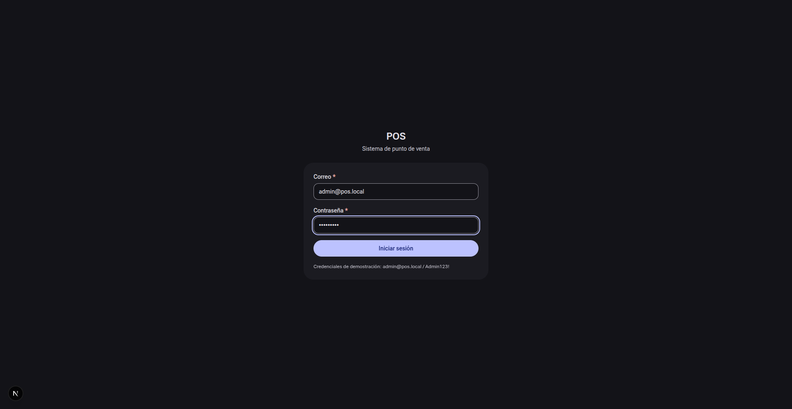

Esta es la primera pantalla que ve cualquier usuario. Pide correo y contraseña, y trae a la vista los datos de prueba para entrar sin complicaciones.

El formulario no guarda nada por su cuenta: cuando alguien inicia sesión, la web le pasa los datos a la API y la API los revisa en la base. Si la API estuviera apagada, aquí no se podría entrar, así que esta pantalla también demuestra que la web está conectada.

### Dashboard

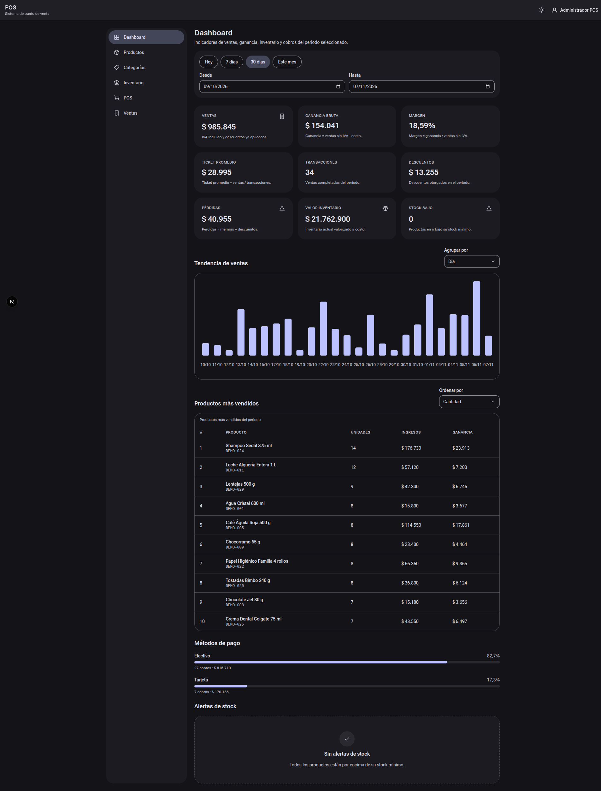

Aquí se ve el resumen del negocio: ventas del periodo, ganancia, ticket promedio y productos más vendidos. Los números no están escritos en la página, se piden a la API cada vez que se abre.

Como los datos salen de PostgreSQL, esta pantalla es la prueba de que la cadena completa funciona. Si alguna pieza fallara, aquí aparecerían errores o todo en cero.

### Punto de venta

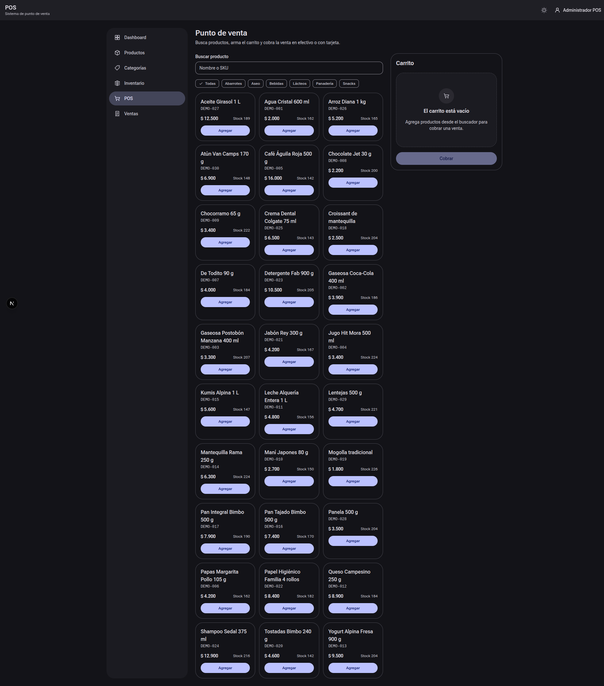

Esta es la pantalla donde se hace una venta de verdad. Se busca el producto, se agrega al carrito y se ve el total con el IVA incluido antes de cobrar.

Cada producto que aparece viene de la base de datos. Por eso esta imagen resume el recorrido completo: la web muestra, la API responde y la base entrega la información.

## Qué aprendimos

- Un contenedor es una copia de una imagen funcionando, y una imagen se arma con un Dockerfile.
- Los servicios se comunican por el nombre que tienen dentro de la red, no por `localhost`.
- El orden de arranque importa, y `depends_on` con `service_healthy` lo resuelve.
- `docker compose ps` dice si está vivo y `docker compose logs` dice qué está pasando.
- Un volumen conserva los datos; un contenedor sin volumen los pierde al borrarse.

## Relación de capturas

| Captura | Qué demuestra |
| :------ | :------------ |
| `captura4.png` | Creación del repositorio en GitHub. |
| `captura5.png` | Repositorio remoto listo, con su dirección. |
| `captura2.png` | Inicio del repositorio local. |
| `captura3.png` | Conexión entre la carpeta local y GitHub. |
| `captura6.png` | Recetas de las dos imágenes. |
| `captura7.png` | Servicios, volumen y red declarados. |
| `captura8.png` | Configuración de la base de datos. |
| `captura9.png` | Configuración de la API y su conexión a la base. |
| `captura10.png` | Configuración de la web y su conexión a la API. |
| `captura11.png` | Construcción y arranque del sistema. |
| `captura12.png` | Los tres contenedores arriba y saludables. |
| `captura13.png` | Arranque de la API y respuestas de la web. |
| `captura14.png` | Red, volumen e IP de cada contenedor. |
| `00-login.png` | Pantalla de acceso de la web. |
| `01-dashboard.png` | Panel de indicadores con datos reales. |
| `02-pos.png` | Punto de venta con productos del catálogo. |
