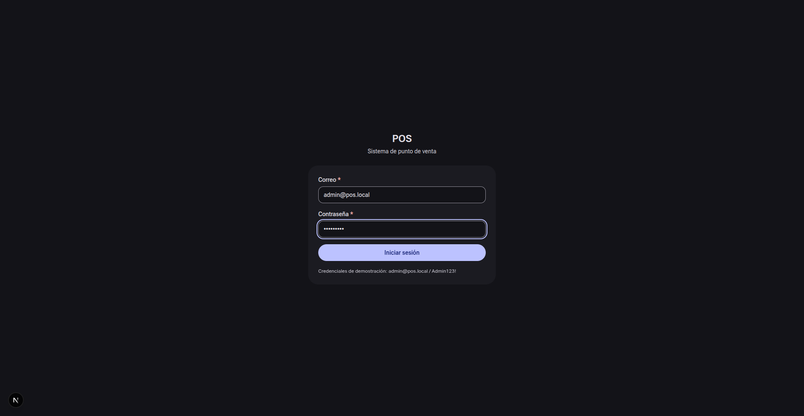
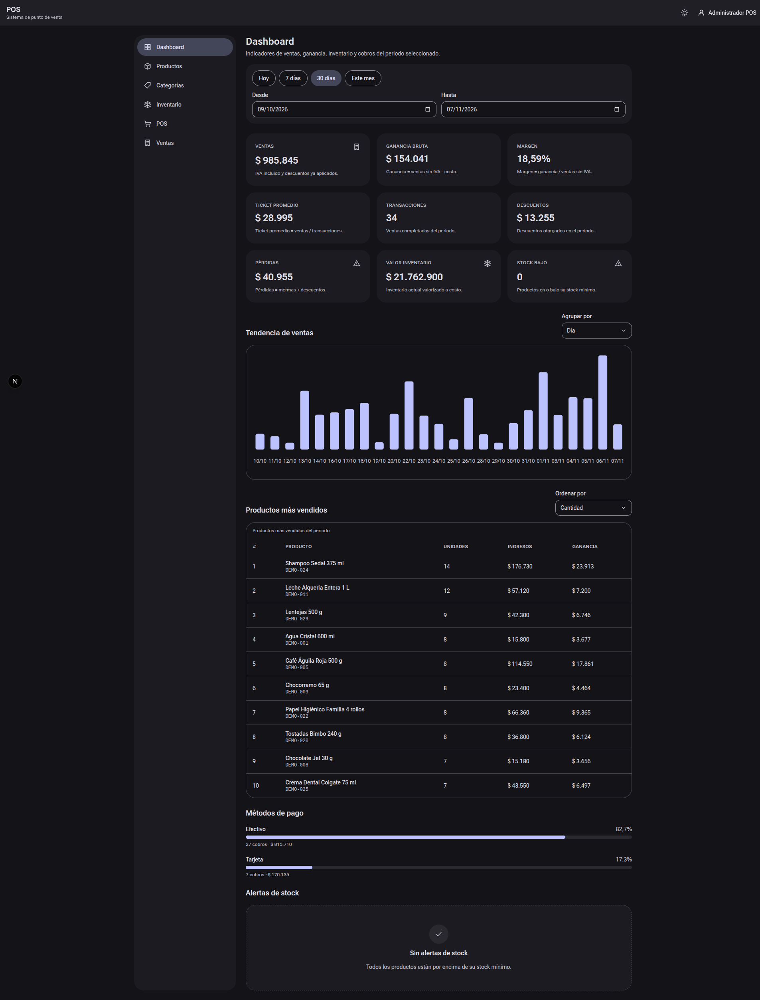
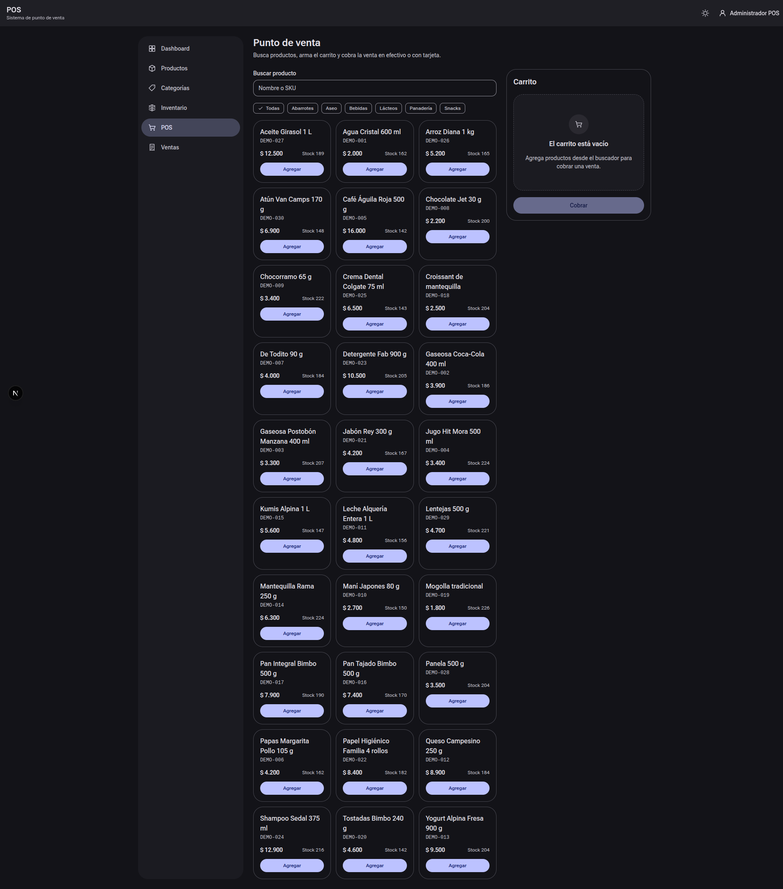
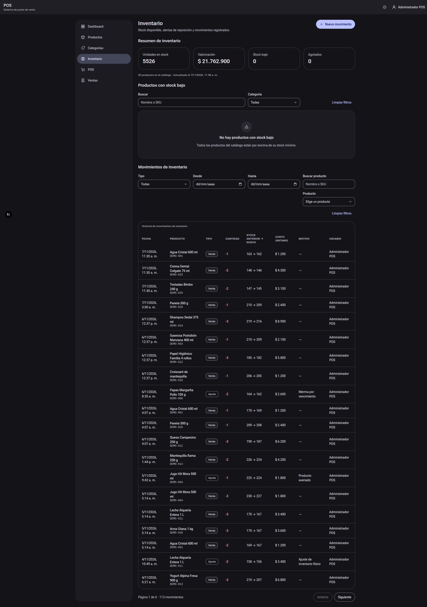
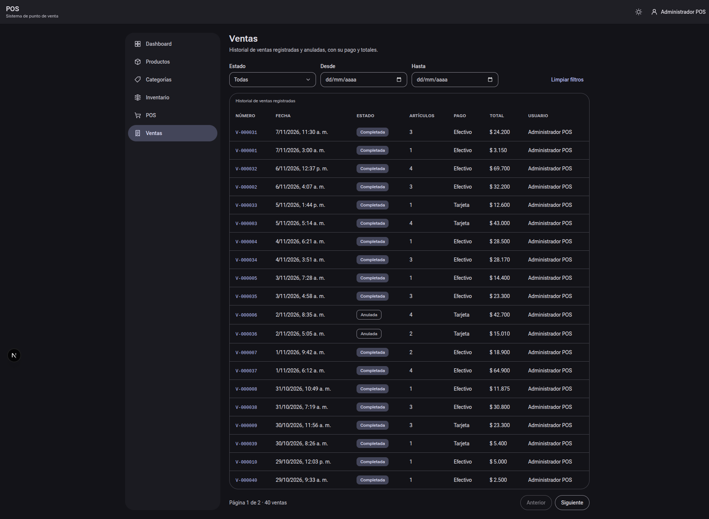
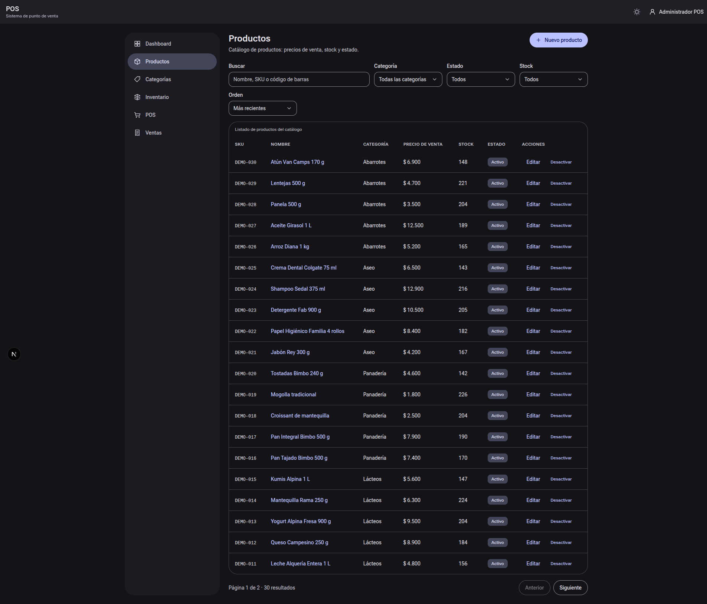
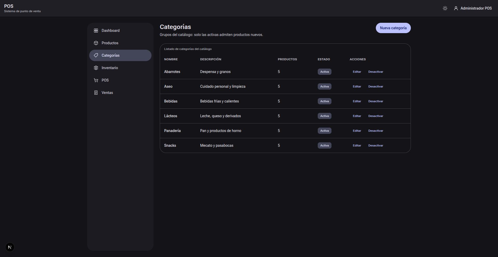

# Capturas de pantalla — POS v1.0.0

> **Propósito:** inventario de las capturas reales del sistema en ejecución (web en `http://localhost:3000` con el seed de demostración) y qué muestra cada una.
>
> **Nota de verificación:** las capturas son archivos reales de este directorio y su contenido coincide con las pantallas servidas por la aplicación en las rutas indicadas. Las descripciones de secciones, controles y columnas se contrastaron contra el árbol de accesibilidad de esas mismas pantallas y contra los componentes de `apps/web/src/components/`.
>
> **Documentos relacionados:** [README del proyecto](../../README.md) · [Arquitectura](../ARQUITECTURA.md) · [API](../API.md) · [Evidencias del procedimiento](EVIDENCIAS.md)

## Galería

### `00-login.png` — Inicio de sesión

Pantalla de `POST /auth/login` expuesta en `/login`:

- Cabecera `POS` con el subtítulo «Sistema de punto de venta».
- Campo **Correo** (marcador `nombre@pos.local`) y campo **Contraseña** (marcador de puntos).
- Botón **Iniciar sesión**.
- Nota de credenciales de demostración: `admin@pos.local / Admin123!`.

### `01-dashboard.png` — Dashboard de KPIs

Ruta `/dashboard`:

- Selector de rango: **Hoy**, **7 días**, **30 días** (por defecto), **Este mes**, más los campos **Desde** y **Hasta**.
- Tarjetas de KPI: **Ventas**, **Ganancia bruta**, **Margen**, **Ticket promedio**, **Transacciones**, **Descuentos**, **Pérdidas**, **Valor inventario** y **Stock bajo**, cada una con su fórmula explicada debajo.
- **Tendencia de ventas**: gráfico de barras en SVG con selector **Agrupar por** (día, semana o mes).
- **Productos más vendidos**: selector **Ordenar por** y tabla `#`, `Producto`, `Unidades`, `Ingresos`, `Ganancia`.
- **Métodos de pago**: reparto entre efectivo y tarjeta con porcentaje, número de cobros e importe.
- **Alertas de stock**: productos en o bajo el stock mínimo, o el estado vacío «Sin alertas de stock».

### `02-pos.png` — Punto de venta

Ruta `/pos`:

- Buscador **Buscar producto** con chips de categoría (incluida **Todas**).
- Panel **Carrito** con las líneas agregadas (nombre, SKU, controles de cantidad, quitar), el campo **Descuento (COP)** y el bloque de totales (subtotal, descuento, IVA incluido y total).
- Botón **Cobrar** (deshabilitado mientras el carrito está vacío), que abre el diálogo de pago en efectivo o con tarjeta.

### `03-inventario.png` — Inventario

Ruta `/inventario`:

- Encabezado con el resumen del módulo y el botón **Nuevo movimiento**.
- **Resumen de inventario**: tarjetas **Unidades en stock**, **Valorización**, **Stock bajo** y **Agotados**, más el total de productos del catálogo y la marca de actualización.
- **Productos con stock bajo**: filtros **Buscar**, **Categoría** y **Limpiar filtros**, con la tabla de reposición.
- **Movimientos de inventario**: filtros **Tipo**, **Desde**, **Hasta**, **Producto** y **Limpiar filtros**, y la tabla `Fecha`, `Producto`, `Tipo`, `Cantidad`, `Stock anterior → nuevo`, `Costo unitario`, `Motivo`, `Usuario`, con paginación **Anterior** / **Siguiente**.

### `04-ventas.png` — Historial de ventas

Ruta `/ventas`:

- Filtro por **Estado** y botón **Limpiar filtros**.
- Tabla `Número` (enlace al detalle, formato `V-000001`), `Fecha`, `Estado` (completada o anulada), `Artículos`, `Pago` (efectivo o tarjeta), `Total` y `Usuario`.

### `05-productos.png` — Catálogo de productos

Ruta `/productos`:

- Botón **Nuevo producto** y filtros **Buscar**, **Categoría**, **Estado**, **Stock** y **Orden**.
- Tabla `SKU`, `Nombre`, `Categoría`, `Precio de venta`, `Stock`, `Estado` y `Acciones` (con el enlace de edición por producto).

### `06-categorias.png` — Categorías

Ruta `/categorias`:

- Botón **Nueva categoría**.
- Tabla `Nombre`, `Descripción`, `Productos` (conteo) y `Estado`, con las acciones **Editar** y **Desactivar** por fila.

## Resumen

| Archivo            | Ruta          | Foco de la captura                                        |
| :----------------- | :------------ | :-------------------------------------------------------- |
| `00-login.png`     | `/login`      | Formulario de acceso y nota de credenciales                |
| `01-dashboard.png` | `/dashboard`  | KPIs, tendencia, ranking, métodos de pago y alertas        |
| `02-pos.png`       | `/pos`        | Buscador de productos, carrito y cobro                     |
| `03-inventario.png`| `/inventario` | Valorización, stock bajo y movimientos                     |
| `04-ventas.png`    | `/ventas`     | Historial de ventas con estado y forma de pago             |
| `05-productos.png` | `/productos`  | Catálogo con filtros y acciones                            |
| `06-categorias.png`| `/categorias` | Listado de categorías con conteo de productos              |

> **Note:** los datos que aparecen en las capturas provienen del seed de demostración (`make seed-demo`): 6 categorías, 30 productos con SKU `DEMO-###` y 40 ventas de los últimos 30 días, de las cuales 6 quedan anuladas. Los importes son en COP con el IVA 19 % incluido.

> **Warning:** el orden de los archivos lleva el prefijo numérico del flujo recomendado (acceso → indicadores → venta → inventario → historial → catálogo) y no el orden del menú lateral.

## Etiquetas

#capturas #ui #material-you #pos #demo
