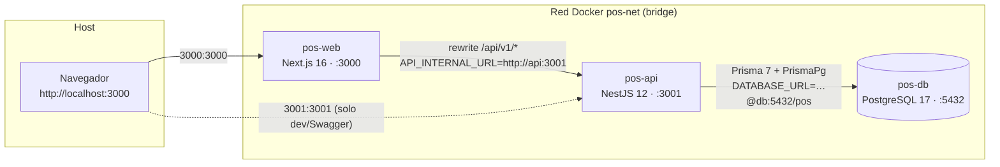
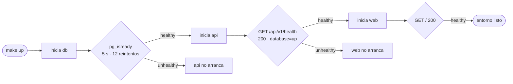
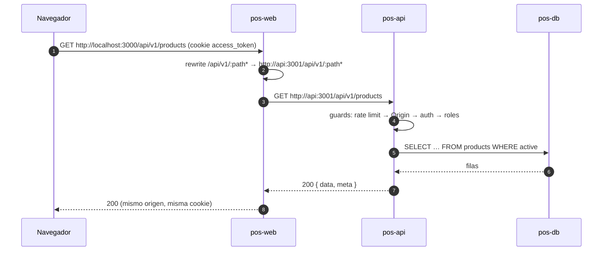

# Docker — configuración e integración de servicios

> **Propósito:** documentar cómo está construido el entorno de contenedores del POS y, sobre todo, **cómo se comunican los servicios entre sí**. Responde al criterio de la actividad «**Dos contenedores conectados**».
>
> **Fuente de verdad:** `docker-compose.yml`, `apps/api/Dockerfile`, `apps/web/Dockerfile`, `infra/postgres/init.sql` y `Makefile` en la versión **v1.0.0** (fase 12 cerrada).
>
> **Documentos relacionados:** [Arquitectura](ARQUITECTURA.md) · [Modelo de datos](MODELO-DATOS.md) · [API](API.md) · [Decisiones](DECISIONES.md) · [README](../README.md)

## Índice

- [Criterio de la actividad](#criterio-de-la-actividad)
- [Topología](#topología)
- [Los contenedores](#los-contenedores)
- [La red `pos-net`](#la-red-pos-net)
- [Arranque ordenado](#arranque-ordenado)
- [Flujos de integración](#flujos-de-integración)
- [Imágenes: Dockerfiles multi-stage](#imágenes-dockerfiles-multi-stage)
- [Persistencia y bases de datos](#persistencia-y-bases-de-datos)
- [Variables de entorno](#variables-de-entorno)
- [Puertos: host vs. red interna](#puertos-host-vs-red-interna)
- [Operación](#operación)
- [Evidencia reproducible](#evidencia-reproducible)
- [Problemas frecuentes](#problemas-frecuentes)

## Criterio de la actividad

> «**Dos contenedores conectados**: La actividad requiere construir **dos contenedores** y garantizar que se encuentren **comunicados entre sí** (por ejemplo, articulando un contenedor para el servicio web/frontend o aplicación con otro contenedor para la base de datos o servidor de aplicaciones).»

| Exigencia | Cómo se cumple en este proyecto | Evidencia |
| :-------- | :------------------------------ | :-------- |
| Construir dos contenedores | Se construyen **tres** imágenes propias: `pos-web` (Next.js), `pos-api` (NestJS) y `pos-db` (PostgreSQL 17). Supera el mínimo de dos. | `docker compose ps` lista los tres como `healthy`. |
| Garantizar la comunicación | Los tres servicios comparten la red de usuario `pos-net`; se resuelven por **nombre de servicio** (`web`, `api`, `db`) mediante el DNS embebido de Docker. | `getent hosts api` dentro de `pos-web` devuelve `172.18.0.3`. |
| Ejemplo web/frontend ↔ base de datos | La cadena real es `web → api → db`: la web reescribe `/api/v1/*` hacia `http://api:3001` y la API consulta PostgreSQL en `db:5432`. | `curl http://localhost:3000/api/v1/health` responde `{"status":"ok","database":"up"}`. |
| Comunicación verificable | Healthchecks con `depends_on: condition: service_healthy` y un smoke test que atraviesa los tres contenedores. | `make smoke` termina en `Smoke OK`. |

> **Note:** no se trata de procesos aislados que comparten el host: comparten una **red de usuario** con resolución de nombres y un orden de arranque garantizado. Esa es la diferencia entre «dos contenedores» y «dos contenedores conectados».

## Topología



- El **navegador** solo conoce `http://localhost:3000`. Nunca habla con la base de datos.
- La **web** traduce `/api/v1/:path*` a la URL interna de la API. El navegador cree que habla con un único origen, y por eso las cookies `httpOnly` viajan siempre al mismo dominio.
- La **API** es el único componente que abre conexiones a PostgreSQL.
- Los puertos `3001` y `5432` publicados al host son una comodidad de desarrollo (Swagger, `psql`); el tráfico entre contenedores **no** los usa.

## Los contenedores

| Servicio | Imagen / build | `container_name` | Puerto publicado | Healthcheck | Depende de | `restart` |
| :------- | :------------- | :--------------- | :--------------- | :---------- | :--------- | :-------- |
| `db` | `postgres:17-alpine` | `pos-db` | `5432:5432` | `pg_isready -U ${POSTGRES_USER:-pos} -d ${POSTGRES_DB:-pos}` | — | `unless-stopped` |
| `api` | `apps/api/Dockerfile`, `target: dev` | `pos-api` | `3001:3001` | `fetch http://127.0.0.1:3001/api/v1/health` | `db` (`service_healthy`) | `unless-stopped` |
| `web` | `apps/web/Dockerfile`, `target: dev` | `pos-web` | `3000:3000` | `fetch http://127.0.0.1:3000` | `api` (`service_healthy`) | `unless-stopped` |

### `db` — PostgreSQL 17

- `POSTGRES_USER`, `POSTGRES_PASSWORD` y `POSTGRES_DB` con valores por defecto `pos` (coinciden con el nombre del proyecto Compose, `name: pos`).
- Volumen nombrado `pos-pgdata` montado en `/var/lib/postgresql/data`: los datos sobreviven a `docker compose down`.
- `./infra/postgres/init.sql` se monta **solo lectura** en `/docker-entrypoint-initdb.d/01-init.sql`. Ese script crea la base `pos_test`, la que usan las pruebas e2e. Solo se ejecuta cuando el directorio de datos está vacío (primer arranque del volumen).
- Healthcheck: `pg_isready` cada 5 s, 12 reintentos y 10 s de gracia. La API no arranca hasta que la base responde.

### `api` — NestJS 12

- Imagen construida desde el contexto raíz (`.`) porque el monorepo necesita el lockfile y los dos `package.json`.
- Variables clave: `DATABASE_URL` (host `db`), `PORT=3001`, `WEB_ORIGIN` (CORS y guard anti-CSRF) y los dos secretos JWT.
- Healthcheck propio: `node -e "fetch('http://127.0.0.1:3001/api/v1/health')"`. No se usa `curl` porque la imagen `bookworm-slim` no lo trae; Node 26 ya expone `fetch` global.
- `GET /api/v1/health` no es un chequeo cosmético: ejecuta `SELECT 1` contra PostgreSQL y responde `503` con `database: "down"` si la base no contesta. Es decir, el healthcheck de la API **también valida el enlace api → db**.

### `web` — Next.js 16

- Variables clave: `PORT=3000` y `API_INTERNAL_URL=http://api:3001`.
- Healthcheck: `fetch` a su propia raíz (`http://127.0.0.1:3000`), que responde el redirect a `/dashboard` o el HTML de login.
- Arranca únicamente cuando la API está `healthy`, de modo que el primer request del usuario no encuentra un proxy sin destino.

## La red `pos-net`

```yaml
networks:
  pos-net:
    name: pos-net
    driver: bridge
```

Los tres servicios declaran `networks: [pos-net]`. Al ser una red **definida por el usuario** (no la `bridge` por defecto), Docker habilita el **DNS embebido**: cada contenedor resuelve a los demás por su nombre de servicio.

| Nombre | Resuelve a | Uso |
| :----- | :--------- | :-- |
| `db` | IP del contenedor `pos-db` | `DATABASE_URL=postgresql://pos:pos@db:5432/pos` |
| `api` | IP del contenedor `pos-api` | `API_INTERNAL_URL=http://api:3001` |
| `web` | IP del contenedor `pos-web` | Acceso desde el host y entre contenedores |

Comprobado en ejecución (las IP pueden cambiar entre arranques; los nombres no):

```console
$ docker compose exec -T web getent hosts api
172.18.0.3      api
$ docker compose exec -T api getent hosts db
172.18.0.2      db
```

> **Warning:** dentro de un contenedor, `localhost` es **ese** contenedor. Por eso `DATABASE_URL` usa `db` y `API_INTERNAL_URL` usa `api`. Si cualquiera de las dos apuntara a `localhost`, el servicio intentaría conectarse consigo mismo y fallaría con `ECONNREFUSED` o `P1001`.

El `container_name` (`pos-api`, `pos-db`, `pos-web`) también es resoluble dentro de la red, pero la configuración usa deliberadamente los **nombres de servicio**: son estables aunque se cambie el `container_name` y funcionan igual en cualquier entorno Compose.

## Arranque ordenado



`depends_on` con `condition: service_healthy` no espera a que el contenedor *exista*, sino a que su healthcheck pase. Eso evita la condición de carrera clásica de «la API arranca antes de que PostgreSQL acepte conexiones».

> **Note:** `restart: unless-stopped` cubre la caída del proceso, no un estado `unhealthy`. Docker no reinicia por su cuenta un contenedor que sigue vivo pero falla el healthcheck; para eso están los reintentos y los logs (`docker compose logs -f api`).

## Flujos de integración

### 1. Navegador → web (same-origin)

`apps/web/next.config.ts` reescribe todo `/api/v1/:path*` hacia `${API_INTERNAL_URL}/api/v1/:path*`:

```ts
const apiInternalUrl = process.env.API_INTERNAL_URL ?? 'http://api:3001';

const nextConfig: NextConfig = {
  output: 'standalone',
  async rewrites() {
    return [
      {
        source: '/api/v1/:path*',
        destination: `${apiInternalUrl}/api/v1/:path*`,
      },
    ];
  },
};
```

Consecuencia práctica: el navegador hace `fetch('/api/v1/products')` contra `localhost:3000`, y **es el servidor de Next** quien abre la conexión a `api:3001`. La cookie `httpOnly` viaja al mismo origen y no hace falta CORS en el cliente.

### 2. API → base de datos

`apps/api/prisma.config.ts` toma `DATABASE_URL` del entorno y el cliente Prisma usa el adapter `PrismaPg`:

```console
$ docker compose exec -T api node -e "console.log(new URL(process.env.DATABASE_URL).host)"
db:5432
```

`PrismaService` reutiliza un pool `pg`; el healthcheck de la API llama a `isHealthy()` (`SELECT 1`) antes de devolver `200`.

### 3. Petición completa (ejemplo real: `GET /api/v1/products`)



### 4. Por qué la web no habla con la base de datos

Aunque el contenedor `web` podría abrir un socket a `db:5432`, no lo hace por diseño:

- Toda regla de negocio (IVA incluido, descuento prorrateado, stock por movimientos, anulación) vive en la API.
- Las credenciales de PostgreSQL no se distribuyen a la capa pública.
- La autorización por rol y el rate limit se aplican en un único punto.
- La base solo es alcanzable desde `api`; eso reduce la superficie de ataque dentro de la red.

## Imágenes: Dockerfiles multi-stage

Ambas imágenes parten de `node:26-bookworm-slim` e instalan `pnpm@12.16.1` global. El monorepo usa `nodeLinker: hoisted`, así que `node_modules` es plano y se puede copiar entre stages sin symlinks rotos.

| Stage | API (`apps/api/Dockerfile`) | Web (`apps/web/Dockerfile`) |
| :---- | :-------------------------- | :-------------------------- |
| `base` | Node 26 + pnpm + `openssl` y `ca-certificates` (Prisma) | Node 26 + pnpm |
| `deps` | Copia manifests y lockfile de ambos workspaces; `pnpm install --no-frozen-lockfile` | Igual |
| `dev` | `COPY . .`, `prisma generate`, `CMD pnpm start:dev` | `COPY . .`, `CMD pnpm dev --hostname 0.0.0.0` |
| `build` | `prisma generate` + `nest build` | `next build` |
| `prod` | Copia `dist`, `prisma/`, `prisma.config.ts` y `node_modules`; `CMD node dist/main.js` | Copia la salida `standalone` + `static` + `public`; `CMD node apps/web/server.js` |

Puntos que explican el diseño:

- **`deps` separado** permite cachear la capa de dependencias: cambiar un `.ts` no reinstala nada.
- **`prisma generate` en `dev` y `build`**: el cliente se genera en `apps/api/src/generated/prisma`, que está ignorado por git y por `.dockerignore`.
- **Sin `devDependencies` eliminadas en `dev`**: las imágenes de desarrollo incluyen Jest, ESLint y Prisma CLI, porque `make api-test`, `make lint-api` y `make migrate` corren `docker compose run --rm api …`.
- **`--no-frozen-lockfile`** es deliberado en las imágenes de desarrollo: el contenedor debe poder arrancar aunque el lockfile se haya regenerado en otra máquina. En CI se usa `--frozen-lockfile`.
- **`output: 'standalone'`** en Next reduce la imagen de producción a lo esencial.

### Sin bind mounts

Salvo `infra/postgres/init.sql`, **el código no está montado**: vive dentro de la imagen. Consecuencias:

- Después de editar cualquier archivo hay que reconstruir: `make build` o `make up` (que ya usa `--build`).
- El `--watch` de Nest y el HMR de Next no ven los cambios del host.
- Las migraciones se generan en un contenedor efímero y se pierden salvo que se monte el directorio (lo hace `make migrate`).
- Beneficio: la imagen que se prueba es exactamente la que se despliega; no hay dependencia del sistema de archivos del host.

`.dockerignore` excluye `node_modules`, `.git`, `.next`, `dist`, `coverage`, `.env*` (salvando `.env.example`), `apps/api/src/generated` y `README.md`.

## Persistencia y bases de datos

| Recurso | Definición | Comportamiento |
| :------ | :--------- | :------------- |
| Volumen `pos-pgdata` | `volumes: pgdata: name: pos-pgdata` | Persiste entre `down`/`up`; solo se borra con `down -v` (`make test-reset`). |
| Base `pos` | `POSTGRES_DB=pos` | La crea la imagen de PostgreSQL al inicializar el volumen. |
| Base `pos_test` | `infra/postgres/init.sql` | La crea el script de inicialización, **solo** en el primer arranque. |
| Migraciones | `apps/api/prisma/migrations` | Se aplican con `make migrate` (`pos`) y `make migrate-test` (`pos_test`). |

```sql
-- infra/postgres/init.sql
CREATE DATABASE pos_test OWNER pos;
```

> **Warning:** si el volumen ya existe, `init.sql` **no** se vuelve a ejecutar. Por eso, tras `docker compose down -v` hay que dejar que el volumen se recree (`make test-reset`) y luego migrar. Si `pos_test` no aparece, el e2e falla con «database does not exist».

## Variables de entorno

`.env.example` documenta los valores y `docker-compose.yml` aplica defaults con `${VAR:-default}`.

| Variable | Default en Compose | Consumidor | Obligatoria |
| :------- | :----------------- | :--------- | :---------- |
| `POSTGRES_USER` | `pos` | `db` | No |
| `POSTGRES_PASSWORD` | `pos` | `db` | No |
| `POSTGRES_DB` | `pos` | `db` | No |
| `DATABASE_URL` | `postgresql://pos:pos@db:5432/pos` | `api` | Sí (validada al arrancar) |
| `PORT` | `3001` | `api` | No |
| `JWT_ACCESS_SECRET` | `dev-access-secret-change-me-…` | `api` | Sí (32+ caracteres) |
| `JWT_REFRESH_SECRET` | `dev-refresh-secret-change-me-…` | `api` | Sí (32+ caracteres) |
| `WEB_ORIGIN` | `http://localhost:3000` | `api` | No |
| `API_INTERNAL_URL` | `http://api:3001` | `web` | No |
| `NODE_ENV` | `development` | `api`, `web` | No |

`validateEnv` detiene el arranque si `DATABASE_URL` o los secretos no cumplen el formato; el contenedor entra en bucle de reinicio y el healthcheck nunca pasa.

> **Warning:** los secretos del compose son **solo de desarrollo**. Fuera de local hay que generar propios (`openssl rand -base64 48`). `.dockerignore` excluye `.env*`, así que no se filtran a la imagen.

## Puertos: host vs. red interna

| Servicio | Puerto del contenedor | Publicado al host | Quién lo usa |
| :------- | :-------------------- | :---------------- | :----------- |
| `web` | `3000` | `3000:3000` | Navegador del usuario. |
| `api` | `3001` | `3001:3001` | Swagger (`/api/docs`), `curl` y depuración. |
| `db` | `5432` | `5432:5432` | `psql` desde el host, inspección manual. |

La sintaxis `HOST:CONTENEDOR` no crea una conexión entre servicios: solo abre una entrada desde el host. Entre contenedores se usa siempre `nombre:puerto_interno` (`api:3001`, `db:5432`).

> **Note:** si se quitara la sección `ports`, el sistema seguiría funcionando entre contenedores; solo se perdería el acceso directo desde el host. Es la prueba de que la integración depende de la red, no de los puertos publicados.

## Operación

Todo pasa por Docker; el host no necesita Node ni pnpm.

| Comando | Efecto |
| :------ | :----- |
| `make up` | `docker compose up -d --build` de `db`, `api` y `web`. |
| `make ps` | Estado y salud de los tres contenedores. |
| `make logs` | Logs en vivo de todos los servicios. |
| `make down` | Detiene y elimina contenedores; conserva `pos-pgdata`. |
| `make build` | Reconstruye las imágenes de `api` y `web`. |
| `make migrate` | `prisma migrate dev` sobre `pos` (monta `apps/api/prisma`). |
| `make migrate-test` | `prisma migrate deploy` sobre `pos_test`. |
| `make seed` / `make seed-demo` | Datos base / datos de demostración. |
| `make test-reset` | `down -v` + reconstrucción: borra el volumen. |
| `make smoke` | Humo end-to-end contra el entorno levantado. |
| `make api-test` | Jest dentro de `pos-api` (`docker compose run --rm api`). |
| `make web-test` | Vitest dentro de `pos-web`. |

Los `run --rm` crean un contenedor efímero con la misma imagen y red; por eso los tests de la API alcanzan `db` sin configuración adicional.

## Evidencia reproducible

Secuencia mínima para demostrar que los contenedores están conectados (ejecutada el **2026-11-07**, salida real).

### 1. Los tres contenedores están arriba y saludables

```console
$ make up
$ docker compose ps
NAME      IMAGE                COMMAND                  SERVICE   STATUS                    PORTS
pos-api   pos-api              "docker-entrypoint.s…"   api       Up (healthy)              0.0.0.0:3001->3001/tcp
pos-db    postgres:17-alpine   "docker-entrypoint.s…"   db        Up (healthy)              0.0.0.0:5432->5432/tcp
pos-web   pos-web              "docker-entrypoint.s…"   web       Up (healthy)              0.0.0.0:3000->3000/tcp
```

### 2. Comparten red y direcciones

```console
$ docker network inspect pos-net --format '{{range .Containers}}{{.Name}} -> {{.IPv4Address}}{{"\n"}}{{end}}'
pos-db -> 172.18.0.2/16
pos-api -> 172.18.0.3/16
pos-web -> 172.18.0.4/16
```

### 3. Se resuelven por nombre

```console
$ docker compose exec -T web getent hosts api
172.18.0.3      api
$ docker compose exec -T api getent hosts db
172.18.0.2      db
```

### 4. La web llama a la API por su nombre de servicio

```console
$ docker compose exec -T web printenv API_INTERNAL_URL
http://api:3001
$ docker compose exec -T web node -e "fetch('http://api:3001/api/v1/health').then(r=>r.text()).then(console.log)"
{"status":"ok","database":"up","timestamp":"2026-11-07T20:28:44.084Z"}
```

### 5. La API llega a la base de datos

```console
$ docker compose exec -T api node -e "console.log(new URL(process.env.DATABASE_URL).host)"
db:5432
$ docker compose exec -T db psql -U pos -d pos -tAc "select 'conexion-ok', current_database();"
conexion-ok|pos
```

### 6. Una sola petición atraviesa los tres contenedores

`/api/v1/health` se pide al puerto de la **web**; Next lo reescribe a la **API**, que consulta **PostgreSQL**:

```console
$ curl -s http://localhost:3000/api/v1/health
{"status":"ok","database":"up","timestamp":"2026-11-07T20:28:39.023Z"}
```

Si `db` estuviera caída, la misma petición devolvería `503` con `"database":"down"`. Es, en una línea, la prueba de que `web → api → db` funciona.

### 7. Smoke end-to-end

```console
$ make smoke
==> Health de la API (http://localhost:3001/api/v1/health)
==> Página de login de la web (http://localhost:3000/login)
==> Inicio de sesión como admin@pos.local
==> GET /auth/me
==> GET /products?pageSize=1
==> GET /inventory/summary
==> GET /sales?pageSize=1
==> GET /dashboard/summary
Smoke OK
```

El login real guarda cookies `httpOnly` y las lecturas posteriores atraviesan `web → api → db` con sesión válida.

### 8. Prueba negativa (opcional, para demostrar el acoplamiento)

```console
$ docker compose stop db
$ curl -s http://localhost:3000/api/v1/health
{"status":"error","database":"down","timestamp":"2026-11-07T20:30:45.681Z"}
$ docker compose start db
$ curl -s http://localhost:3000/api/v1/health
{"status":"ok","database":"up","timestamp":"2026-11-07T20:30:53.899Z"}
```

La web sigue en pie, pero la API responde `503` con `"database":"down"` y, tras agotar los 12 reintentos del healthcheck (≈2 min), `docker compose ps` la marca `unhealthy`. Al reiniciar `db` el pool de Prisma se reconecta sin reiniciar la API. Es la prueba de que la comunicación es real y no decorativa.

## Problemas frecuentes

| Síntoma | Causa | Solución |
| :------ | :---- | :------- |
| `ECONNREFUSED` en llamadas `/api/v1/*` desde la web | `API_INTERNAL_URL` apunta a `localhost` o a `127.0.0.1` | Debe ser `http://api:3001` dentro de Compose. |
| `P1001: Can't reach database server` en la API | `DATABASE_URL` con host incorrecto o `db` aún arrancando | Verificar host `db` y esperar el healthcheck (`make ps`). |
| `pos_test does not exist` | El volumen ya existía cuando se añadió `init.sql` | `make test-reset` (borra el volumen y recrea). |
| Cambios de código que no aparecen | No hay bind mounts | `make up` o `make build`. |
| `relation "_prisma_migrations" does not exist` | Faltan migraciones en la base | `make migrate` (y `make migrate-test` para e2e). |
| `403` al ejecutar mutaciones desde Swagger | `Origin` no está en `WEB_ORIGIN` | Añadir `http://localhost:3001` a `WEB_ORIGIN`. |
| `port is already allocated` al levantar | Otro proceso ocupa `3000`, `3001` o `5432` | Liberar el puerto o cambiar el mapeo en `docker-compose.yml`. |
| Migraciones creadas dentro del contenedor desaparecen | El directorio no estaba montado | Usar `make migrate`, que ya monta `apps/api/prisma`; luego `chown` de los archivos. |

---

## Enlaces

- [Arquitectura](ARQUITECTURA.md) — capas, guards y flujo de datos.
- [Modelo de datos](MODELO-DATOS.md) — entidades, índices y fórmulas.
- [API](API.md) — endpoints, cookies y ejemplos `curl`.
- [Decisiones](DECISIONES.md) — ADRs del proyecto.
- [README](../README.md) — puesta en marcha y comandos.

## Etiquetas

#docker #compose #postgresql #nestjs #nextjs #pos
