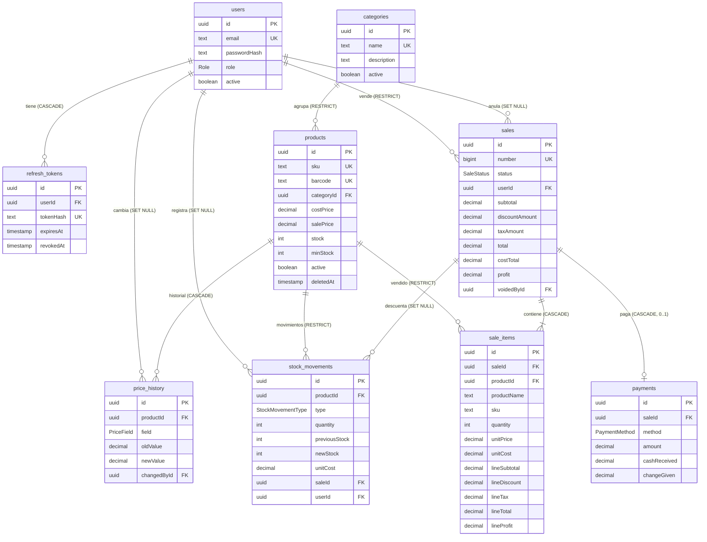

# Modelo de datos — POS

> **Propósito:** documentar las entidades, enums, relaciones, índices, restricciones y fórmulas del POS tal como existen en `apps/api/prisma/schema.prisma` y en `apps/api/prisma/migrations/`.
>
> **Fuente de verdad:** el `schema.prisma` y el SQL versionado. Si este documento y el schema difieren, mandan el schema y la migración.
>
> **Documentos relacionados:** [Arquitectura](ARQUITECTURA.md) · [API](API.md) · [Decisiones](DECISIONES.md) · [README](../README.md)

## Convenciones

| Convención            | Implementación                                                                                 |
| :-------------------- | :--------------------------------------------------------------------------------------------- |
| Nombres de tabla      | `snake_case` vía `@@map` (`products`, `stock_movements`, …)                                     |
| Claves primarias      | `String @id @default(uuid()) @db.Uuid`                                                          |
| Dinero                | `Decimal @db.Decimal(14, 2)` en pesos colombianos (COP)                                         |
| Fechas                | `TIMESTAMP(3)` persistidas en **UTC**; el negocio se lee en `America/Bogota` (ver §Fórmulas)     |
| Borrado de catálogo   | Lógico: `active: false` + `deletedAt: now()`; las lecturas filtran `deletedAt: null`            |
| Cliente Prisma        | Generator `prisma-client` en `apps/api/src/generated/prisma` (gitignored) + adapter `PrismaPg`  |

## Enums

| Enum                | Valores                                  | Uso                                                            |
| :------------------ | :--------------------------------------- | :------------------------------------------------------------- |
| `Role`              | `ADMIN`, `CASHIER`                       | `users.role` (el MVP solo crea `ADMIN`)                          |
| `PriceField`        | `COST`, `SALE`                           | `price_history.field`                                           |
| `StockMovementType` | `ENTRY`, `SALE`, `ADJUSTMENT`, `VOID`    | `stock_movements.type`                                          |
| `SaleStatus`        | `COMPLETED`, `VOIDED`                    | `sales.status`                                                  |
| `PaymentMethod`     | `CASH`, `CARD`                           | `payments.method`                                               |

## Diagrama ER



## Entidades

### `users`

| Columna        | Tipo           | Nulo | Notas                                    |
| :------------- | :------------- | :--: | :--------------------------------------- |
| `id`           | `UUID`         |  No  | PK, `uuid()`                             |
| `name`         | `TEXT`         |  No  | Nombre visible                           |
| `email`        | `TEXT`         |  No  | **Único**; el servicio lo normaliza a minúsculas |
| `passwordHash` | `TEXT`         |  No  | bcrypt con coste 12                      |
| `role`         | `Role`         |  No  | Por defecto `ADMIN`                      |
| `active`       | `BOOLEAN`      |  No  | Por defecto `true`; desactivar revoca las sesiones |
| `createdAt` / `updatedAt` | `TIMESTAMP(3)` | No | Auditoría                          |

### `refresh_tokens`

| Columna     | Tipo           | Nulo | Notas                                                        |
| :---------- | :------------- | :--: | :----------------------------------------------------------- |
| `id`        | `UUID`         |  No  | PK                                                            |
| `userId`    | `UUID`         |  No  | FK → `users.id`, `ON DELETE CASCADE`                          |
| `tokenHash` | `TEXT`         |  No  | **Único**; HMAC-SHA256 del token con `JWT_REFRESH_SECRET` como _pepper_ |
| `expiresAt` | `TIMESTAMP(3)` |  No  | 7 días desde la emisión                                       |
| `revokedAt` | `TIMESTAMP(3)` |  Sí  | `null` mientras la sesión sigue viva                          |
| `userAgent` | `TEXT`         |  Sí  | Contexto de la emisión                                        |
| `ip`        | `TEXT`         |  Sí  | Contexto de la emisión                                        |
| `createdAt` | `TIMESTAMP(3)` |  No  | Por defecto `CURRENT_TIMESTAMP`                               |

### `categories`

| Columna       | Tipo           | Nulo | Notas                                                    |
| :------------ | :------------- | :--: | :------------------------------------------------------- |
| `id`          | `UUID`         |  No  | PK                                                        |
| `name`        | `TEXT`         |  No  | **Único**; unicidad sin distinguir mayúsculas en el servicio |
| `description` | `TEXT`         |  Sí  | `null` para vaciarla                                      |
| `active`      | `BOOLEAN`      |  No  | Por defecto `true`; `DELETE` hace borrado lógico          |
| `createdAt` / `updatedAt` | `TIMESTAMP(3)` | No | Auditoría                                      |

### `products`

| Columna       | Tipo            | Nulo | Notas                                                                 |
| :------------ | :-------------- | :--: | :-------------------------------------------------------------------- |
| `id`          | `UUID`          |  No  | PK                                                                     |
| `sku`         | `TEXT`          |  No  | **Único**; se recorta y se guarda en mayúsculas                        |
| `barcode`     | `TEXT`          |  Sí  | **Único** (permite varios `null`)                                      |
| `name`        | `TEXT`          |  No  | Nombre comercial                                                       |
| `description` | `TEXT`          |  Sí  | —                                                                      |
| `categoryId`  | `UUID`          |  No  | FK → `categories.id`, `ON DELETE RESTRICT`                             |
| `costPrice`   | `DECIMAL(14,2)` |  No  | Costo vigente (base del costo promedio ponderado)                      |
| `salePrice`   | `DECIMAL(14,2)` |  No  | Precio final **con IVA 19% incluido**                                  |
| `stock`       | `INTEGER`       |  No  | Por defecto `0`; solo lo modifican los movimientos de inventario        |
| `minStock`    | `INTEGER`       |  No  | Umbral de alerta; `lowStock = stock <= minStock`                       |
| `unit`        | `TEXT`          |  No  | Por defecto `'unidad'`                                                 |
| `imageUrl`    | `TEXT`          |  Sí  | URL de la imagen                                                       |
| `active`      | `BOOLEAN`       |  No  | Por defecto `true`                                                     |
| `deletedAt`   | `TIMESTAMP(3)` |  Sí  | Marca del borrado lógico                                               |
| `createdAt` / `updatedAt` | `TIMESTAMP(3)` | No | Auditoría                                                  |

### `price_history`

| Columna       | Tipo            | Nulo | Notas                                                            |
| :------------ | :-------------- | :--: | :--------------------------------------------------------------- |
| `id`          | `UUID`          |  No  | PK                                                                |
| `productId`   | `UUID`          |  No  | FK → `products.id`, `ON DELETE CASCADE`                          |
| `field`       | `PriceField`    |  No  | `COST` o `SALE`                                                   |
| `oldValue`    | `DECIMAL(14,2)` |  No  | Valor anterior (`0` en las entradas iniciales de la creación)     |
| `newValue`    | `DECIMAL(14,2)` |  No  | Valor nuevo                                                       |
| `changedById` | `UUID`          |  Sí  | FK → `users.id`, `ON DELETE SET NULL` (usuario que cambió)        |
| `createdAt`   | `TIMESTAMP(3)`  |  No  | Orden del historial                                               |

### `stock_movements`

| Columna         | Tipo                | Nulo | Notas                                                                     |
| :-------------- | :------------------ | :--: | :------------------------------------------------------------------------ |
| `id`            | `UUID`              |  No  | PK                                                                        |
| `productId`     | `UUID`              |  No  | FK → `products.id`, `ON DELETE RESTRICT`                                  |
| `type`          | `StockMovementType` |  No  | `ENTRY`, `SALE`, `ADJUSTMENT`, `VOID`                                     |
| `quantity`      | `INTEGER`           |  No  | **Firmada**: positiva en entradas y anulaciones, negativa en ventas y mermas |
| `previousStock` | `INTEGER`           |  No  | Stock antes del movimiento                                                |
| `newStock`      | `INTEGER`           |  No  | Stock después del movimiento                                              |
| `unitCost`      | `DECIMAL(14,2)`     |  No  | Costo con el que se valoriza el movimiento                                 |
| `reason`        | `TEXT`              |  Sí  | Obligatorio en `ADJUSTMENT`; guarda el motivo de la anulación en `VOID`    |
| `saleId`        | `UUID`              |  Sí  | FK → `sales.id`, `ON DELETE SET NULL`                                     |
| `userId`        | `UUID`              |  Sí  | FK → `users.id`, `ON DELETE SET NULL`                                     |
| `createdAt`     | `TIMESTAMP(3)`      |  No  | Orden cronológico de la trazabilidad                                       |

### `sales`

| Columna          | Tipo            | Nulo | Notas                                                     |
| :--------------- | :-------------- | :--: | :-------------------------------------------------------- |
| `id`             | `UUID`          |  No  | PK                                                         |
| `number`         | `BIGINT`        |  No  | **Único**; de `nextval('sale_number_seq')`, expuesto como `V-000001` |
| `status`         | `SaleStatus`    |  No  | Por defecto `COMPLETED`                                    |
| `userId`         | `UUID`          |  No  | FK → `users.id`, `ON DELETE RESTRICT` (quien vende)        |
| `subtotal`       | `DECIMAL(14,2)` |  No  | Suma de líneas **antes** del descuento, con IVA incluido   |
| `discountAmount` | `DECIMAL(14,2)` |  No  | Descuento global efectivamente prorrateado                 |
| `taxAmount`      | `DECIMAL(14,2)` |  No  | IVA 19% **incluido** en el total                           |
| `total`          | `DECIMAL(14,2)` |  No  | `subtotal - discountAmount`; es lo que se cobra            |
| `costTotal`      | `DECIMAL(14,2)` |  No  | Costo congelado de las líneas                              |
| `profit`         | `DECIMAL(14,2)` |  No  | Ganancia: `(total - taxAmount) - costTotal`                |
| `createdAt`      | `TIMESTAMP(3)`  |  No  | Fecha de la venta                                          |
| `voidedAt`       | `TIMESTAMP(3)`  |  Sí  | Marca de la anulación                                      |
| `voidedById`     | `UUID`          |  Sí  | FK → `users.id`, `ON DELETE SET NULL`                      |
| `voidReason`     | `TEXT`          |  Sí  | Motivo de la anulación (3 a 255 caracteres)                |

### `sale_items`

| Columna        | Tipo            | Nulo | Notas                                                        |
| :------------- | :-------------- | :--: | :----------------------------------------------------------- |
| `id`           | `UUID`          |  No  | PK                                                            |
| `saleId`       | `UUID`          |  No  | FK → `sales.id`, `ON DELETE CASCADE`                          |
| `productId`    | `UUID`          |  No  | FK → `products.id`, `ON DELETE RESTRICT`                      |
| `productName`  | `TEXT`          |  No  | **Snapshot** del nombre al momento de la venta                 |
| `sku`          | `TEXT`          |  No  | **Snapshot** del SKU                                           |
| `quantity`     | `INTEGER`       |  No  | Entero `>= 1` (check en SQL)                                   |
| `unitPrice`    | `DECIMAL(14,2)` |  No  | **Snapshot** del precio con IVA incluido                       |
| `unitCost`     | `DECIMAL(14,2)` |  No  | **Snapshot** del costo                                         |
| `lineSubtotal` | `DECIMAL(14,2)` |  No  | `unitPrice * quantity`                                         |
| `lineDiscount` | `DECIMAL(14,2)` |  No  | Parte prorrateada del descuento global                         |
| `lineTax`      | `DECIMAL(14,2)` |  No  | IVA incluido en `lineTotal`                                    |
| `lineTotal`    | `DECIMAL(14,2)` |  No  | `lineSubtotal - lineDiscount`                                  |
| `lineProfit`   | `DECIMAL(14,2)` |  No  | `lineTotal - lineTax - unitCost * quantity`                    |

### `payments`

| Columna        | Tipo            | Nulo | Notas                                                |
| :------------- | :-------------- | :--: | :--------------------------------------------------- |
| `id`           | `UUID`          |  No  | PK                                                    |
| `saleId`       | `UUID`          |  No  | FK → `sales.id`, `ON DELETE CASCADE`; **único**: un pago por venta |
| `method`       | `PaymentMethod` |  No  | `CASH` o `CARD`                                       |
| `amount`       | `DECIMAL(14,2)` |  No  | Igual al `total` de la venta                          |
| `cashReceived` | `DECIMAL(14,2)` |  Sí  | Solo `CASH`; debe ser `>= total`                      |
| `changeGiven`  | `DECIMAL(14,2)` |  Sí  | Solo `CASH`: `cashReceived - total`                   |
| `createdAt`    | `TIMESTAMP(3)`  |  No  | —                                                     |

## Índices

### Índices de `20261107014248_init`

| Tabla             | Índice                              | Columnas                     | Tipo    |
| :---------------- | :---------------------------------- | :--------------------------- | :------ |
| `users`           | `users_email_key`                   | `email`                      | Único   |
| `refresh_tokens`  | `refresh_tokens_tokenHash_key`      | `tokenHash`                  | Único   |
| `refresh_tokens`  | `refresh_tokens_userId_idx`         | `userId`                     | Normal  |
| `categories`      | `categories_name_key`               | `name`                       | Único   |
| `products`        | `products_sku_key`                  | `sku`                        | Único   |
| `products`        | `products_barcode_key`              | `barcode`                    | Único   |
| `products`        | `products_categoryId_idx`           | `categoryId`                 | Normal  |
| `products`        | `products_name_idx`                 | `name`                       | Normal  |
| `products`        | `products_active_idx`               | `active`                     | Normal  |
| `price_history`   | `price_history_productId_createdAt_idx` | `productId`, `createdAt` | Normal  |
| `stock_movements` | `stock_movements_productId_createdAt_idx` | `productId`, `createdAt` | Normal |
| `stock_movements` | `stock_movements_saleId_idx`        | `saleId`                     | Normal  |
| `sales`           | `sales_number_key`                  | `number`                     | Único   |
| `sales`           | `sales_createdAt_idx`               | `createdAt`                  | Normal  |
| `sales`           | `sales_status_idx`                  | `status`                     | Normal  |
| `sales`           | `sales_userId_idx`                  | `userId`                     | Normal  |
| `sale_items`      | `sale_items_saleId_idx`             | `saleId`                     | Normal  |
| `sale_items`      | `sale_items_productId_idx`          | `productId`                  | Normal  |
| `payments`        | `payments_saleId_key`               | `saleId`                     | Único   |

### Índices de `20261107162329_perf_indexes` (cierre técnico)

| Tabla             | Índice                              | Columnas                       | Consulta que lo justifica                                        |
| :---------------- | :---------------------------------- | :----------------------------- | :--------------------------------------------------------------- |
| `products`        | `products_active_deletedAt_idx`     | `active`, `deletedAt`          | Listados y KPIs que filtran `active: true, deletedAt: null`       |
| `sales`           | `sales_status_createdAt_idx`        | `status`, `createdAt`          | KPIs y tendencia: `status = COMPLETED` + rango de `createdAt`     |
| `stock_movements` | `stock_movements_type_createdAt_idx` | `type`, `createdAt`           | Mermas del dashboard: `type = ADJUSTMENT` + rango de `createdAt`  |

> **Note:** los tres índices compuestos amplían índices simples ya existentes (`products_active_idx`, `sales_status_idx`); el Índice original se conserva.

## Restricciones que solo viven en SQL

Prisma no modela estos `CHECK`; están escritos a mano en `20261107014248_init`:

| Constraint                          | Tabla         | Regla                    |
| :---------------------------------- | :------------ | :----------------------- |
| `products_stock_non_negative`       | `products`    | `stock >= 0`             |
| `products_cost_price_non_negative`  | `products`    | `"costPrice" >= 0`       |
| `products_sale_price_non_negative`  | `products`    | `"salePrice" >= 0`       |
| `sale_items_quantity_positive`      | `sale_items`  | `quantity > 0`           |
| `sales_total_non_negative`          | `sales`       | `total >= 0`             |

> **Warning:** `prisma migrate diff` no ve estos `CHECK`. Si se modifica el schema y se genera una migración nueva, hay que conservarlos a mano (ver [DECISIONES](DECISIONES.md)).

## Secuencia `sale_number_seq`

```sql
CREATE SEQUENCE "sale_number_seq"
  START WITH 1
  INCREMENT BY 1
  NO MINVALUE
  NO MAXVALUE
  CACHE 1;
```

`sales.number` **no** es autoincremental: `SalesService` la consume dentro de la transacción de la venta con `SELECT nextval('sale_number_seq')` y el mapper la expone con el formato `V-000001` (`formatSaleNumber`, `apps/api/src/modules/sales/sales.mapper.ts`). `resetDatabase()` en los tests y `truncate.ts` en el seed demo reinician la secuencia con `RESTART WITH 1`.

## Migraciones

| Migración                          | Contenido                                                                                     |
| :--------------------------------- | :-------------------------------------------------------------------------------------------- |
| `20261107014248_init`              | Tablas, enums, índices, claves foráneas y los cinco `CHECK` de dominio                         |
| `20261107014300_sale_number_seq`   | Secuencia `sale_number_seq` para el consecutivo de venta                                       |
| `20261107162329_perf_indexes`      | Índices compuestos `products(active, deletedAt)`, `sales(status, createdAt)`, `stock_movements(type, createdAt)` |

```bash
make migrate        # prisma migrate dev sobre pos (desarrollo)
make migrate-test   # prisma migrate deploy sobre pos_test (previo a los e2e)
make migrate-deploy # prisma migrate deploy sin prompts (CI/producción)
make reset          # prisma migrate reset --force + seed base
```

## Fórmulas

### IVA 19% incluido

```text
lineTax  = lineTotal - round(lineTotal / 1.19)
taxAmount = Σ lineTax
```

`IVA_DIVISOR = 1.19` y todas las operaciones se hacen en **centavos enteros** (`toCents` / `fromCents`) para evitar errores de coma flotante (`apps/api/src/modules/sales/sales.calculator.ts`).

### Descuento prorrateado

```text
lineDiscount_i = floor(lineSubtotal_i * discountCents / subtotalCents)
residuo        = discountCents - Σ lineDiscount_i   (se reparte de a 1 centavo, en orden)
```

Reglas verificadas: el descuento no puede superar el subtotal (`400`), siempre es `>= 0` y el reparto del residuo va de la primera a la última línea.

### Ganancia

```text
lineProfit_i = lineTotal_i - lineTax_i - unitCost_i * quantity_i
profit       = Σ lineProfit_i        (equivale a (total - taxAmount) - costTotal)
```

### Costo promedio ponderado (entradas de inventario)

```text
costoNuevo = round2( (stockActual * costoActual + cantidad * unitCost) / (stockActual + cantidad) )
```

Solo aplica a movimientos `ENTRY`; si el costo resultante cambia se registra una entrada en `price_history` con `field: COST`. Los `ADJUSTMENT` **no** tocan el costo: el `unitCost` guardado es el vigente del producto.

### Pérdidas y KPIs del dashboard

| Indicador         | Fórmula verificada                                                             |
| :---------------- | :----------------------------------------------------------------------------- |
| `totalSales`      | `Σ sales.total` (IVA incluido, ya sin descuento)                                |
| `grossSales`      | `Σ sales.subtotal` (con IVA incluido y antes del descuento)                      |
| `netSales`        | `Σ (sales.total - sales.taxAmount)` — ventas sin IVA, base del margen           |
| `grossProfit`     | `Σ sales.profit`                                                                |
| `margin`          | `grossProfit / netSales * 100`, dos decimales; `0` si `netSales = 0`            |
| `averageTicket`   | `totalSales / transactionCount`, dos decimales; `0` sin ventas                  |
| `discounts`       | `Σ sales.discountAmount`                                                        |
| `shrinkage`       | `Σ abs(quantity) * unitCost` de `stock_movements` con `type = ADJUSTMENT` y `quantity < 0` |
| `losses`          | `shrinkage + discounts`                                                         |
| `inventoryValue`  | `Σ products.stock * products.costPrice` de productos activos y no eliminados     |
| `lowStockCount`   | Productos activos con `stock <= minStock` (incluye agotados)                     |
| `outOfStockCount` | Productos activos con `stock = 0`                                               |

Solo entran ventas `COMPLETED`: las `VOIDED` quedan fuera de todos los KPIs. La tendencia agrupa por día, semana (cae al lunes) o mes en la zona `America/Bogota` (`BOGOTA_TIME_ZONE`, `apps/api/src/modules/dashboard/dashboard.mapper.ts`), aunque `createdAt` se persiste en UTC.

## Factories y seeds

| Pieza                              | Contenido                                                                                        |
| :--------------------------------- | :----------------------------------------------------------------------------------------------- |
| `prisma/factories/`                | _Builders_ puros (`buildUser`, `buildCategory`, `buildProduct`, `buildPriceHistory`, `buildStockMovement`, `buildSaleItem`, `buildSale`, `buildPayment`) y _creators_ con `PrismaClient`. |
| `prisma/seed.ts`                   | Idempotente (upsert): admin `admin@pos.local` / `Admin123!`, 6 categorías y 12 productos.        |
| `prisma/seed-demo.ts`              | Vacía el negocio y genera 30 productos (6 categorías × 5), 40 ventas de los últimos 30 días (6 anuladas), 5 mermas y 5 cambios de precio. |
| `faker.seed(2026)`                 | Semilla fija en ambos seeds: los datos son reproducibles.                                        |
| `prisma/truncate.ts`               | `TRUNCATE` del negocio + `ALTER SEQUENCE sale_number_seq RESTART WITH 1`.                        |

---

## Enlaces

- [Arquitectura](ARQUITECTURA.md) — capas, guards y flujo de datos.
- [API](API.md) — endpoints que exponen este modelo.
- [Decisiones](DECISIONES.md) — por qué Prisma 7 + `PrismaPg`, entre otras.
- [README](../README.md) — puesta en marcha y comandos de migración y seed.

## Etiquetas

#modelo-de-datos #prisma #postgresql #pos #er-diagram
